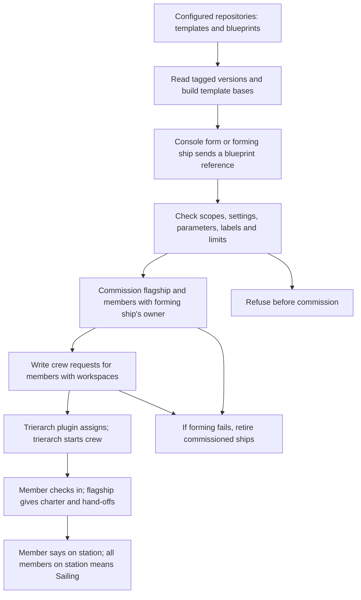
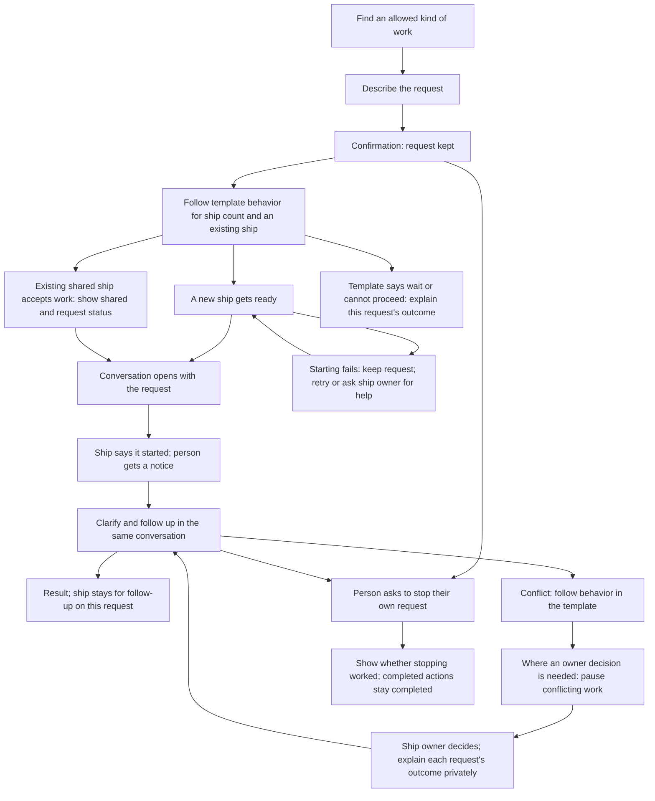

# Asking for a ship by what it does

## Approved purpose

A person asks for a ship by what it does, gives it a request, and gets a ship that is crewed and starts on that request without the person arranging how it runs.

This is for a business user. Templates describe the work available to ask for. Some are single, with at most one ship of that template at a time in a fleet; others are multiple, with one ship per request. These are the needs in [#41](https://github.com/ThomasHendrickx/aeolus-fleet-squadrons/issues/41), not an agreed implementation or an ownership rule.

Thomas approved this purpose, option 1. His direction, verbatim:

> We do need to look at this from the user experience, not technical. UX first, and technical follows after that.

## Lessons to check against

1. **Start with the person's work.** The person should not need to choose a blueprint, assemble hand-offs, supply a workspace or paste a crew line to get started. Today's forming flow needs those parts supplied by files or the forming actor. Hiding a developer form would leave that work with the person.
2. **Keep core content-blind and ship-agnostic.** Core commissions ships, enforces scopes and reach, keeps crew requests and delivers messages. It does not interpret a business request, select work or coordinate execution. Squadrons already owns templates, blueprints and forming, in its own process and database (0017). Any proposed change to that boundary needs an explicit question, not an assumed exception.
3. **Build on the template that actually runs.** Templates are versioned files in configured repositories. A base is built into a complete template with a recorded chain; forming keeps a snapshot. A template, a template version, a ship type and a squadron role are different concrete parts. Today's role count and role type belong to one squadron, so neither establishes the fleet-wide single-template guarantee.
4. **Permission to ask and the ship's powers are separate.** Today `squadrons:form` permits forming, and template scopes must be held by the forming ship, checked again by core through `ownerOf`. This is no per-template permission to ask. A scope says what an actor may do, while network rules say where. Receiving a request through a plugin does not grant its sender new rights (0046, 0057).
5. **Ownership answers accountability, not who happened to ask last.** A ship has one owner, a person ship or argo; questions, gates and trouble go there (0045). Today squadrons uses the forming ship's owner. The person requesting a ship's existence owns it; the template has a separate owner who defines its behavior. The asker, the owner and other people using the ship must not silently become interchangeable. Argo is the fail-safe, not the normal destination for work.
6. **Reach must be explicit.** Owners reach their ships; replies have a built-in route; squadron members reach one another through declared rules. Asking for a shared ship does not by itself give lasting send, read or manage reach, or access to another person's request. Meetings can let invited participants converse, but do not decide ownership or settle conflicting requests (0034, 0061).
7. **Commissioned, crewed and started are different facts.** A workspace enables today's crew request; the trierarch plugin assigns it and a trierarch starts a session. A member then checks in, receives its charter and says it is on station. `crew.firstPrompt` is first-start only. Neither commission nor a crewed status proves that the person's request reached the crew or that work began.
8. **A retry must keep the person's request.** Today's form stores its answer per forming ship and key; core separately makes commission and send repeatable. Forming retires ships it commissioned when a step is refused. The new flow must account for simultaneous asks, lost answers, partial forming and restarts without losing a request or creating a second single ship. Message acknowledgement proves receipt, not completion of the requested work (0040).
9. **Single does not settle conflicting work.** One exclusive crew lease does not establish how two people's incompatible requests are handled. The template owner supplies behavior for the ship count, an ask while one exists and conflicting requests; Aeolus does not choose that behavior.
10. **Keep a person's entry outside the admin console.** People act through their accounts and person ships in their app, chat or gateway; core's console is for fleet administration (0043, 0054, 0057). Where the person asks and what they can discover need to fit that existing boundary. Discovery today describes reachable ships and types, not templates that do not yet have ships (0047).

## How it works today

The [squadrons documentation](../../squadrons.md) describes this existing path, not a proposed flow for asking for a ship:



- A template contains charter, check-in interval, hand-offs, parameters, scopes, labels and optional crew settings. A blueprint chooses versioned templates, role counts and hand-off bindings. A base changes how a template is built, not how a person requests work.
- Forming by message requires `squadrons:form`, a blueprint reference and a key. Members formed this way require workspaces and are crewed by crew requests; secrets never travel in these messages.
- The flagship relays between members and the forming ship. A retired forming ship's owner takes its place under the existing scopes. This is not yet a route for several independent askers to a single ship.
- Limits bound squadrons per fleet, squadrons per forming ship and members per squadron. They do not impose at most one ship of a template across a fleet.
- Existing template scopes describe powers granted to members. They do not identify which people may ask for which templates. The issue's access premise therefore needs clarification rather than a claim that per-template access exists today.

## Approved experience

### 1. Find and ask

The person picks from a list of kinds of work described in everyday words, then describes the request. They do not arrange how the ship runs.

### 2. Wait and return

The person gets confirmation that the request is kept, sees "getting ready" or "started", and gets a notice when work starts. They can leave and come back. If starting fails, the request stays and they are told what they can do.

### 3. Work in a conversation

The conversation opens with the person's request. The ship says it started, asks for clarification there and gives the result there. Ready is never shown as started.

### 4. Bespoke and shared ships

A template can define bespoke ships, unique per request and never shared. A template can instead allow at most one ship in a fleet. Its owner writes what happens when someone asks while that ship already exists. Aeolus does not choose that behavior.

When the template's behavior lets a person give an existing shared ship work, the person is told it is shared and whether their request started or waits. Nobody sees other people's conversations.

Thomas's note, verbatim:

> Type of ship can define that it should always be bespoke, so unique per request. Then those are never shared.

### 5. Conflicting requests

The template owner writes the behavior for handling conflicts in the template. Where that behavior calls for an owner's decision, the conflicting work pauses and the ship's owner decides. Each affected person is told privately; neither sees the other's request. Work that does not conflict keeps going. This is behavior on the ships, not native conflict policy in core.

Thomas's note on conflict policy, read with the template clarification in question 10, verbatim:

> Can be also set as a policy / rule on a ship by the owner (not natively in aeolus core) on how to handle conflicts

### 6. Follow up and stop

The person can follow up, clarify or stop their own request. They cannot change other people's work or end a shared ship. Stopping shows whether it worked, never that completed actions were undone.

### 7. Who may ask

People see the kinds of work their organisation has allowed them to ask for; the rest is not shown. Being allowed to ask is separate from what the ship itself may do. The organisation sets both.

### 8. Ship ownership and template ownership

The person requesting a ship's existence owns that ship, shared or not. A shared ship does not need an owner named beforehand. The template has its own owner, who manages how ships made from it act; that person need not own those ships. Everyone can see who answers for a ship. Clarifications about a request stay in that person's conversation.

The option requiring the organisation to name a shared ship's owner beforehand does not apply.

Thomas's notes, verbatim:

> A ships owner is the one requesting it's existence. A template (or whatever we call it) also has a template owner.

> No wrong, a shared ship does not need an owner up front. Shared or not still the one requesting it was the owner. What I said was that a template also has an owner. Example if I have a template called Baker, the template owner can be mike as he is the one managing the template that defines how the ship should act. Becky requested a baker ship so she will be the owner of that ship. Frans also requests a baker ship so frans as well is the owner of a baker ship.
> 2 ships with 2 different owners and Mike still is owner of the baker template.
>
> Come back with new questions if needed.

### 9. Asking when the allowed ship already exists

How many ships are allowed and what happens when someone asks while one exists are behavior the template owner writes in the template. Aeolus does not choose between giving work to an existing ship, waiting, refusing or making another ship. The template's stated limit and behavior govern the case. The Baker example distinguishes ship ownership from template ownership; it does not itself specify that template's limit.

Thomas's answer to revised question 9, verbatim:

> Again I don't get the question. If it is defined in the template that there can max be one, than this conflict is resolved through a rule in that template.

### 10. Where conflict behavior belongs

Approved option 2: conflict behavior is captured in the template, set by the template owner for every ship of it. An individual ship's owner cannot change it. There is no separate ship-owner policy editor or conversation command proposed here.

Thomas's note, verbatim:

> This is behaviour captured in the template

### 11. Explain waiting and decisions privately

Approved option 2: give a reason about the person's own request, such as waiting to start or waiting for the owner's decision. After a decision, say whether the request continues, keeps waiting or cannot go ahead. Reveal nothing about anyone else's request and promise no times.

### 12. Retry or get help when starting fails

Approved option 1: try again with the kept request, or ask the ship's owner for help from it. Show whether a retry is under way. The person need not describe the request again.

### 13. Follow up after bespoke work ends

Approved option 2: the conversation and ship stay for follow-up on that request. Different work gets a new bespoke ship. Conversation history stays as long as the fleet keeps it. Completing or stopping work does not itself retire the ship or release its crew.

Thomas's note, verbatim:

> Retiring a ship or releasing a crew are active actions the user asks for.. or the agent the user is using offcourse

### 14. Who settles a conflict on a single ship

Approved option 1: the template's rule decides. Where it hands a case to the owner, that is the ship's owner, not automatically the template owner. The design does not choose a conflict policy for the template owner to follow.

Thomas's note, verbatim:

> Basic rule for aeolus has been to enable as many options to these types of questions as possible, allowing behaviour to be set in templates gives maximum flexibility while being transparent.

## What the template can state

The template owner supplies the behavior for:

- how many ships may exist, including a bespoke ship per request or at most one in the fleet;
- what happens when someone asks while the allowed ship already exists;
- how conflicting requests are handled, including whether a case needs the ship owner's decision.

These describe work and behavior the template owner fills in. The technical choices below separate the enforced count setting from owner-written instructions; they do not introduce a native core policy language.

## The person's journey



### Happy paths

A person chooses an allowed kind of work, describes the request and gets confirmation it is kept. Where the template calls for a new ship, the person requesting its existence owns it. It gets ready without that person arranging how it runs. The person can leave and return, gets a start notice and continues in a conversation opening with the request. Clarifications and the result belong there.

Where the template accepts work on an existing single shared ship, another person gives it their own request. They see that the ship is shared and whether their work waits or starts. The conversation remains private. Asking for work on an existing ship is not itself a rule for changing that ship's owner; behavior for an ask while one exists comes from the template.

For bespoke work, the ship and conversation stay available for follow-up on that request. Different work gets a new bespoke ship. History follows the fleet's retention. Retiring the ship or releasing its crew requires an active request from the user or their agent.

### Unhappy paths and returning to the work

| Situation | What the person sees and does |
| --- | --- |
| Starting fails | The request stays. Try again from it or ask the ship's owner for help; see whether a retry is under way. It is not shown as started. |
| A single ship already exists | The template's rule determines what happens. Explain whether this person's request waits, starts or cannot go ahead, without exposing another person's request. |
| Two requests conflict | Follow the template's conflict behavior. Where it needs the ship owner's decision, pause conflicting work and tell affected people privately. Non-conflicting work continues. Explain each person's own outcome without promising times. |
| The ship needs clarification | The person answers in the conversation containing their request. |
| The person leaves before work starts | Return to the kept request and its current status; get a start notice when work starts. |
| The person wants to stop | Ask to stop their own request and see whether it worked. Other people's work and the shared ship are not ended. Completed actions are not presented as undone. |
| The person wants work they are not allowed to ask for | That kind of work is absent from their choices. No access-request flow is proposed here. |

## Technical design

The approved purpose and lessons remain the starting point. The experience is approved; answers 15 through 22 establish the boundaries below. The detailed structure and unresolved questions are design proposals, not implementation approval.

### Approved technical choices

| Question | Approved choice | Consequence |
| --- | --- | --- |
| 15: template rules | Option 2: an enforced count setting; other behavior as template-owner instructions | Concurrent asks cannot bypass the count. Instructions reach whichever ship handles a case before it acts. |
| 16: template owner | Option 2: set by the fleet when making the template available | Portable files name no fleet-specific person. A base's author does not automatically own templates built on it. |
| 17: asking rights | Option 2: each template names the rights needed to ask; the organisation grants them | Check the actual actor when listing and again when asking. Asking rights differ from ship powers. |
| 18: placement | Option 1: squadrons, with its own page and ship; the person's app presents it | Core keeps its generic jobs; the conversation stays in the person's app. |
| 19: ship powers | Option 2: the organisation approves rights a template's ships may get | Requester ownership stays intact. A small explicit core rights extension may be needed; no bypass of core checks. |
| 20: count guarantee | Option 1: squadrons claims the available place before commission | A restart reconciles half-finished cases instead of creating another ship. |
| 21: privacy | Option 1: one conversation per person and request, using existing app and fleet access checks | No extra isolation inside a shared crew. Its crew sees what it is given; a template wanting privacy should be bespoke. |
| 22: recovery | Option 2: squadrons keeps the request and progress, sending work as a message tied to it | Retry continues that request. The ship explicitly says when it started; no duplicate ship or lost request. |

### Parts and boundaries

| Part | Responsibility |
| --- | --- |
| Template file and built template | Existing charter, crew settings, parameters and powers, plus the enforced count setting, required asking rights and instructions for existing-ship and conflict cases. Keep the version and built base chain used. |
| Template made available in a fleet | Its fleet-set template owner and organisation-approved ship powers, separate from the portable file and the resulting ship's owner. |
| Squadrons | Available templates, authorisation of asks, durable requests and progress, count claims, commission and crew-request steps, recovery and request-to-ship/message associations. Its domain and ports remain independent of frameworks and core internals. |
| Ship handling a template case | Receives the relevant template instructions before acting. Decides the case according to those instructions, without overriding count or rights checks. Individual-template forming uses one named ship for pre-creation cases. Its charter, owner and rights require approval before it is created. |
| Requested ship's crew | Takes the request as a message, explicitly reports starting it, handles clarification, follow-up and stopping, and sends replies tied to that request. |
| Person's app | Presents the allowed choices, durable progress and separate conversations; authenticates the person and does not expose another person's request. It never lends its person ship's crew token to squadrons. |
| Core | Authenticates actors; checks scopes, ownership and reach; commissions, keeps crew requests and delivers opaque messages. It does not read templates or choose business behavior. |
| Trierarch plugin and trierarch | Assign the existing crew request and start, restart or wake the crew. They do not decide which work a template accepts. |

The new fields' exact names, base merge rules and message shapes are not fixed by these answers. They must preserve the existing meaning of template versions, snapshots and parameter substitution. A template owner writes behavior; a template file alone is never a grant of powers.

### Authorisation and the recorded core approval

Listing checks the signed-in account or actual sending ship, scoped to its fleet. Asking rechecks the required rights, even if the person saw that template earlier. A message cannot claim a different actor or carry usable rights. A request key belongs to that actor in that fleet; another person cannot use it to read or change the request.

There are three separate checks: may this actor ask for this template; which powers has the organisation approved for ships made from it; and may this operation reach its target. Neither template ownership nor asking permission grants the resulting ship arbitrary powers or reach. Reusing a ship does not change its owner or broaden its powers merely because another person asks for work.

Today's `ownerOf` commission check uses the asking ship both for ownership and as the scope source. It cannot, by itself, express a requester who owns the new ship but does not hold all its powers. The approved core addition is a recorded commission approval: who approved which rights and which commissioner may use them, with requester ownership set separately. Core must verify the authoriser may grant every requested scope, that the authorisation applies to this commission and fleet, and record the actor and source. Squadrons must not simulate this by commissioning under a powerful owner and silently changing ownership afterward.

Core keeps and checks that approval when commissioning the ship. Approval authority, revocation and version binding still require design before any build; this is not yet an available API. Any required change to decisions 0045/0046, the public compatibility contract and the minimum core version belongs in the implementation design before code. Asking and template behavior remain outside core.

### Durable requests and the count

Proposed structure: squadrons keeps each accepted request with its fleet, actual requester, selected built template, original request, progress, resulting ship association, and the commission/send references needed to resume. The acceptance write precedes confirmation that the request is kept. Repeating the same request key returns that request; it does not create another one. Reusing a key for different content must be distinguished from retrying the original request.

For a template with an available place, the count claim and decision to create belong to one local transaction. All processes serving that fleet share this claim. Commission uses a stable key from the recorded creation step. A lost commission response is reconciled with the same key before any new commission is attempted. A claim is not freed just because a request finished, its crew was released or the process restarted: the ship still exists. A confirmed retirement or confirmed failed commission permits reconciliation of the place. A retry never retires a working shared ship to make room.

Count every version of the same repository and template name together across every squadrons forming path, including blueprint forming and individual-template forming. A new version opens no second place. Squadrons records the template association for each ship it forms. Ships created outside templates are not counted. Changing the count while ships exist needs its own design and never automatically retires ships.

### Complete flow

This diagram shows the approved responsibilities and the proposed sequence. Individual-template forming, a named case-handling ship and recorded core approval are approved choices. The case ship's charter, owner and rights, and the approval's authority, revocation and version rules remain design dependencies.

```mermaid
sequenceDiagram
    actor Person
    participant App as Person's app
    participant S as Squadrons
    participant H as Ship handling template case
    participant C as Core
    participant T as Trierarch plugin and trierarch
    participant W as Requested ship
    Person->>App: Find work
    App->>S: List available templates as the actual actor
    S-->>App: Allowed choices only
    Person->>App: Choose and describe request
    App->>S: Ask with repeatable key
    S->>S: Recheck rights; keep request and progress
    S-->>App: Request kept
    S->>S: Check existing ship and claim available place atomically
    alt Template needs a decision for an existing ship
        S->>H: Relevant template instructions and minimum case context
        H-->>S: Outcome under template instructions
        S-->>App: This request waits, proceeds or cannot proceed
    end
    alt Create a new ship
        S->>C: Repeatable commission with requester ownership and approved powers
        C-->>S: Ship reference or refusal
        S->>C: Write crew request with supplied settings
        C-->>T: Crew request available
        T->>W: Start crew
        S-->>W: Built template charter and instructions before work
    else Existing ship may take work
        S->>S: Keep existing owner and associate this request
    end
    S->>C: Repeatable send tied to request
    C->>W: Deliver request with only needed context
    W->>S: Explicitly report this request started
    S-->>App: Started and start notice
    W-->>App: Request-bound clarification or result through checked route
    Person->>App: Follow up or stop own request
    App->>S: Authorised follow-up or stop tied to request
    S->>C: Send to associated ship
    C->>W: Deliver follow-up or stop
    W-->>App: Outcome for this request
```

The requested ship being crewed or acknowledging a delivery does not mark the work started. A refusal to send remains visible on the kept request. The app reads progress after returning; closing the app does not own or cancel recovery. Reply routing must validate the ship-to-request association and the person entitled to that conversation, not trust a recipient supplied in a payload.

Asking for one template uses individual-template forming in squadrons, not an implicit one-member squadron. Existing blueprint forming keeps its snapshot, crew request and check-in path and participates in the same template count. The individual ship must receive its built charter before work; its exact instruction hand-over needs specification without assuming a flagship. One named ship handles pre-creation cases; its charter, owner and rights return for approval before it is created.

### Happy and unhappy paths

| Path | Result and recovery |
| --- | --- |
| New bespoke ship | Check asking rights and approved powers, keep request, claim place, commission once, request crew, supply instructions, send request and wait for the ship's explicit start report. Conversation and ship stay for follow-up. |
| Existing single ship | Preserve the count and owner. Give the case-handling ship its template instructions before deciding what happens; keep and explain this person's outcome privately. Accepting work does not expose other conversations. |
| Two simultaneous asks | The shared claim admits no more commissions than the setting allows. The other request follows the template's existing-ship behavior; it is not silently dropped or assigned a second ship. |
| Not allowed, unavailable template or invalid ask | Refuse without commission. Do not confirm a request was kept before it is durably accepted. Recheck rights after listing; show no forbidden choices or other requests. |
| Confirmation lost | Repeating the same key finds the kept request and its progress. It does not repeat business work as a new request. |
| Commission answer lost or restart after commission | Reconcile the recorded creation key and ship before proceeding. Keep the place claimed while the outcome is unknown. |
| Commission refused | Keep the failed progress and explanation. Reconcile that no ship exists before freeing the place; retry remains the same request. |
| Crew settings refused or no computer can take the request | Show getting ready or failure with the reason and permitted next action. Do not claim started, lose the original request or release the count merely because no crew runs. |
| Restart around sending | Resume the recorded send with its stable key. Core's delivery recovery and the ship's request association prevent creating a new request; business execution is not claimed to be exactly once. |
| Send refused by rights, reach or unavailable core | Keep progress and the original request for retry or owner help. Do not mark delivered or started. |
| Crew dies after delivery | Core recovers deliveries by its existing contract. Squadrons retains request progress; the new crew receives needed context rather than relying on a first prompt running again. |
| Requests conflict | The ship handling the case receives the template's conflict instructions first. Where an owner decision is called for, pause conflicting work for the ship owner. Continue non-conflicting work and explain only the affected person's outcome. |
| Stop races with start | Keep both facts and route stop to the same request. Show the confirmed stop outcome; do not imply actions already completed were undone. Do not stop another request or retire a shared ship. |
| Explicit release or retirement | Apply existing core authorisation and lifecycle. Release leaves the ship existing; retirement triggers count reconciliation. Never automatically retire merely because work finished. |

These are guarantees to prove in implementation with concurrency, rollback and restart tests, not claims that the current package already provides them.

### Conversation privacy and reads

Access is checked in the app and by fleet scopes/reach, with squadrons checking request ownership and reply association. A shared ship's send reach is not permission for a person to read every request it serves. An app cannot derive a private request conversation by returning the entire exchange with that shared ship or filtering other people's payloads in the browser.

A shared ship's crew sees what it is given. Separate conversations and existing app and fleet access checks do not isolate context inside that crew. No extra isolation inside a shared crew is proposed. A template wanting privacy should be bespoke.

Thomas's clarification on question 21, verbatim:

> privacy on a shared ship -> a shared ship has the disadvantages it has. So no unneeded over engineering

Design for 3,000 ships and 10 million messages per fleet. Choices and request histories are paged and filtered before returning to the app; request-to-ship and claim lookups are indexed by fleet and identity. No full fleet or message-history scan belongs on the ask path. Read budgets are p95 under 100 ms, p99 under 500 ms and errors under 1%, to be measured when built. Loading, empty, refusal, failure and partial-progress states are distinct. A cache of template availability cannot substitute for the ask-time rights check.

### Approved structure: answers 23 through 25

- **23, option 2:** squadrons forms one ship from one template. One named ship handles cases before the requested ship exists. Its charter, owner and rights return for approval; nothing is created by this design round.
- **24, option 1:** core keeps a recorded approval of who approved which rights and for whom to use. It checks that approval at commission and sets ownership separately. Approval authority, taking approval back and version rules are designed before building.
- **25, option 1:** count every version and every forming path of the same template together. A new version never opens a second place. Ships created outside templates are excluded. Changing a count while ships exist has its own design, never automatic retirement.

### Remaining design before implementation

The approved choices do not yet settle the following concrete parts:

- The name, charter, owner, crew and rights of the ship handling pre-creation cases, and how squadrons gives it instructions and accepts its outcome without giving it a way around count or rights checks.
- Who may record core approval, how it is withdrawn, how it binds versions, and the exact generic public contract and audit record. The core decisions and compatibility contract must describe the approved addition before implementation.
- The individual ship's instruction hand-over before work, without assuming the existing flagship check-in works for a ship outside a squadron.
- The count-change flow for templates with existing ships. It must preserve the no-automatic-retirement direction.

These need concrete proposals for approval, not a reopening of which business behavior template owners may write. No ship is created and no rights are granted in this design round.

## Approval boundary

The purpose, UX direction and experience answers above incorporate Thomas's ownership correction and his direction that template owners supply ship-count, existing-ship and conflict behavior. The journey follows those answers without choosing that behavior for a template. Answers 15 through 25 approve the technical choices recorded above, with shared-crew privacy limited by Thomas's clarification. The remaining design dependencies above must be resolved before implementation approval. No code is changed.

## Sources

- [Issue #41, including Thomas's words](https://github.com/ThomasHendrickx/aeolus-fleet-squadrons/issues/41).
- [Templates, bases, blueprints, forming and check-in](../../squadrons.md).
- [Squadrons boundary, ownership and forming](../../decisions/0017-squadrons-package.md).
- [Fleet blueprint: purpose, owners, commission, scopes, network, crew requests and meetings](https://github.com/ThomasHendrickx/aeolus-fleet/blob/main/docs/blueprint.md).
- [Fleet decisions index](https://github.com/ThomasHendrickx/aeolus-fleet/blob/main/docs/decisions/README.md), especially 0017, 0026, 0029, 0034, 0040, 0043, 0045, 0046, 0047, 0050, 0053, 0054, 0057 and 0061.
- [Public core calls available to squadrons](https://github.com/ThomasHendrickx/aeolus-fleet/blob/main/docs/compatibility.md).
