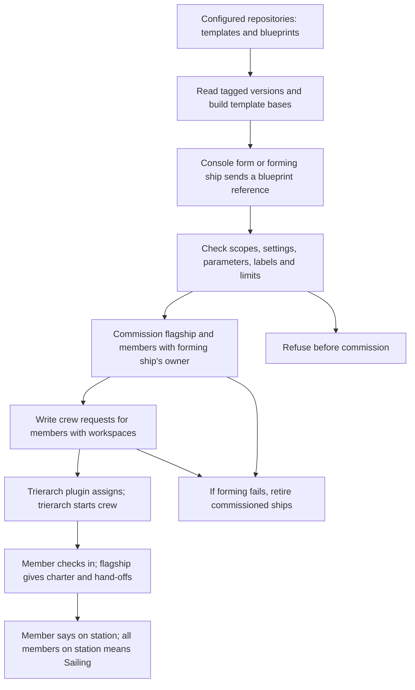

# Asking for a ship by what it does

## Approved purpose

A person asks for a ship by what it does, gives it a request, and gets a ship that is crewed and starts on that request without the person arranging how it runs.

This is for a business user. Templates describe the work available to ask for. Some are single, with at most one ship of that template at a time in a fleet; others are multiple, with one ship per request. These are the needs in [#41](https://github.com/ThomasHendrickx/aeolus-fleet-squadrons/issues/41), not an agreed implementation or an ownership rule.

Thomas approved this purpose, option 1. His direction, verbatim:

> We do need to look at this from the user experience, not technical. UX first, and technical follows after that.

## Lessons to check against

1. **Start with the person's work.** The person should not need to choose a blueprint, assemble hand-offs, supply a workspace or paste a crew line to get started. Today's forming flow needs those parts supplied by files or the forming actor. Hiding a developer form would leave that work with the person.
2. **Keep core content-blind and ship-agnostic.** Core commissions ships, enforces scopes and reach, keeps crew requests and delivers messages. It does not interpret a business request, select work or coordinate execution. Squadrons already owns templates, blueprints and forming, in its own process and database (0017). Any proposed change to that boundary needs an explicit question, not an assumed exception.
3. **Build on the template that actually runs.** Templates are versioned files in configured repositories. A base is built into a complete template with a recorded chain; forming keeps a snapshot. A template, a template version, a ship type and a squadron role are different concrete parts. Today's role count and role type belong to one squadron, so neither establishes the fleet-wide single-template guarantee.
4. **Permission to ask and the ship's powers are separate.** Today `squadrons:form` permits forming, and template scopes must be held by the forming ship, checked again by core through `ownerOf`. This is no per-template permission to ask. A scope says what an actor may do, while network rules say where. Receiving a request through a plugin does not grant its sender new rights (0046, 0057).
5. **Ownership answers accountability, not who happened to ask last.** A ship has one owner, a person ship or argo; questions, gates and trouble go there (0045). Today squadrons uses the forming ship's owner. A single ship serving several people makes that existing default a design question. The asker, the owner and other people using the ship must not silently become interchangeable. Argo is the fail-safe, not the normal destination for work.
6. **Reach must be explicit.** Owners reach their ships; replies have a built-in route; squadron members reach one another through declared rules. Asking for a shared ship does not by itself give lasting send, read or manage reach, or access to another person's request. Meetings can let invited participants converse, but do not decide ownership or settle conflicting requests (0034, 0061).
7. **Commissioned, crewed and started are different facts.** A workspace enables today's crew request; the trierarch plugin assigns it and a trierarch starts a session. A member then checks in, receives its charter and says it is on station. `crew.firstPrompt` is first-start only. Neither commission nor a crewed status proves that the person's request reached the crew or that work began.
8. **A retry must keep the person's request.** Today's form stores its answer per forming ship and key; core separately makes commission and send repeatable. Forming retires ships it commissioned when a step is refused. The new flow must account for simultaneous asks, lost answers, partial forming and restarts without losing a request or creating a second single ship. Message acknowledgement proves receipt, not completion of the requested work (0040).
9. **Single does not settle conflicting work.** One exclusive crew lease does not establish how two people's incompatible requests are handled. Ordering, refusal, cancellation and who may steer the ship need answers before an implementation can claim to serve both people.
10. **Keep a person's entry outside the admin console.** People act through their accounts and person ships in their app, chat or gateway; core's console is for fleet administration (0043, 0054, 0057). Where the person asks and what they can discover need to fit that existing boundary. Discovery today describes reachable ships and types, not templates that do not yet have ships (0047).

## How it works today

The [squadrons documentation](../../squadrons.md) describes this existing path, not a proposed flow for asking for a ship:

- A template contains charter, check-in interval, hand-offs, parameters, scopes, labels and optional crew settings. A blueprint chooses versioned templates, role counts and hand-off bindings. A base changes how a template is built, not how a person requests work.
- Forming by message requires `squadrons:form`, a blueprint reference and a key. Members formed this way require workspaces and are crewed by crew requests; secrets never travel in these messages.
- The flagship relays between members and the forming ship. A retired forming ship's owner takes its place under the existing scopes. This is not yet a route for several independent askers to a single ship.
- Limits bound squadrons per fleet, squadrons per forming ship and members per squadron. They do not impose at most one ship of a template across a fleet.
- Existing template scopes describe powers granted to members. They do not identify which people may ask for which templates. The issue's access premise therefore needs clarification rather than a claim that per-template access exists today.

## Questions about the person's experience

Answers marked approved are agreed behavior; unanswered options and picks remain proposals for discussion. Start with asking, waiting and working with the ship; permissions and ownership follow from that experience. Technical design follows later.

### 1. How does a person find and ask for the work they need?

1. See the kinds of work available to them, each described in everyday words, choose one and describe their request.
2. Describe their need in a conversation and have a ship suggest what to ask for, confirming before starting.
3. Offer both, so a person can browse or describe their need.

**Approved answer: option 1.** The person picks from a list of kinds of work described in everyday words, then describes the request.

**Pick: 1.** It gives the person a clear promise of what they can ask for without requiring them to know ship names or how ships run. A conversational route can follow if needed.

### 2. What does the person see while their ship gets ready?

1. Stay on a waiting screen until the ship starts.
2. Get a confirmation that the request is kept, see whether the ship is getting ready or has started, and be told when it starts; they can leave and return.
3. Get only a message once the ship has started.

**Approved answer: option 2.** The person gets confirmation that the request is kept, then sees "getting ready" or "started", and gets a notice when it starts. They can leave and come back. If starting fails, the request stays and they are told what they can do.

**Pick: 2.** The person knows their request was received and can leave without wondering whether to ask again. If starting fails, show that it has not started, keep the request visible and explain what they can do next without asking them to arrange how the ship runs.

### 3. What does the person get when work starts?

1. A conversation with the ship, showing the original request, where the ship says it has started and later asks for clarification or gives the result.
2. A page showing progress and results, without a conversation.
3. A notification that it started, with results sent later.

**Approved answer: option 1.** The person gets a conversation with the ship, opening with their request. The ship says it started, asks for clarification there and gives the result there. Ready is never shown as started.

**Pick: 1.** It gives the person a place to continue the work, correct a misunderstanding and see the result. A ship being ready alone must not be presented as having started the request.

### 4. What happens when the work uses a single ship that already exists?

1. Let the person give that ship a request, clearly saying it is shared and whether their request has started or is waiting; do not show other people's conversations merely because the ship is shared.
2. Say the ship is already in use and ask the person to return later.
3. Ask the person already using it to let the next person use it.

**Approved answer: option 1.** The person gives the existing ship their request too. It says the ship is shared and whether their request started or waits; nobody sees other people's conversations.

Thomas's note, verbatim:

> Type of ship can define that it should always be bespoke, so unique per request. Then those are never shared.

**Pick: 1.** Single means one ship for that work in the fleet, rather than one person's exclusive possession. People can still ask for work without finding and negotiating with the previous asker. This does not yet settle which requests can run together.

### 5. What happens when two people's requests conflict on that ship?

1. Finish the earlier request before starting the later one, even when their outcomes conflict.
2. Tell the people their requests conflict and pause the conflicting work until the ship's owner gives direction; do not expose either person's private request to the other.
3. Give the later request priority and stop the earlier one.

**Pick: 2.** Arrival order should not silently decide incompatible business outcomes. Each person sees what is happening to their own request, and one accountable person resolves the conflict. Ordinary requests that do not conflict need not wait for that decision.

### 6. What can a person do after asking?

1. Follow up, clarify or ask to stop their own request, without changing other people's work or ending a shared ship.
2. Direct all work on the ship, including stopping other people's requests.
3. Read the result only; a change requires another request.

**Pick: 1.** The person can steer the work they asked for without becoming responsible for everyone using a shared ship. Asking to stop must show whether stopping succeeded, rather than implying completed actions were undone.

### 7. Who can ask for each kind of work?

1. Everyone in the fleet can ask for every kind of work.
2. People see and can ask for the kinds of work their organisation has allowed them to use; work they cannot use is left out.
3. Everyone sees every kind of work, but must request approval for anything they cannot yet use.

**Pick: 2.** The choices shown are usable promises. Asking for work should not also require permission to perform every action the ship does; the organisation must decide both who may ask and what the ship may do. Whether requesting access is needed can be considered separately.

### 8. Who answers for the ship when it needs a decision?

1. The first person who asks owns it, including a shared ship.
2. The asker owns a ship made for their request; a single shared ship has a named owner chosen by the organisation before people use it. People can see who answers for it.
3. The organisation names the owner for every ship, including those made for one person's request.

**Pick: 2.** A ship made for one person's request has a clear person to turn to, while a shared ship's questions and conflicting requests do not become the first asker's responsibility by accident. Clarifications about an individual request belong in that person's conversation; decisions the ship's owner must make go to its owner under the existing ownership rule.

## Approval boundary

The purpose, Thomas's UX-first direction and the answers to questions 1 through 4, including Thomas's note about bespoke ships, are approved. Questions 5 through 8 await answers. No API, data or squadrons/core placement decisions are proposed in this round. A full proposed flow with happy and unhappy paths follows the experience decisions, before implementation design.

## Sources

- [Issue #41, including Thomas's words](https://github.com/ThomasHendrickx/aeolus-fleet-squadrons/issues/41).
- [Templates, bases, blueprints, forming and check-in](../../squadrons.md).
- [Squadrons boundary, ownership and forming](../../decisions/0017-squadrons-package.md).
- [Fleet blueprint: purpose, owners, commission, scopes, network, crew requests and meetings](https://github.com/ThomasHendrickx/aeolus-fleet/blob/main/docs/blueprint.md).
- [Fleet decisions index](https://github.com/ThomasHendrickx/aeolus-fleet/blob/main/docs/decisions/README.md), especially 0017, 0026, 0029, 0034, 0040, 0043, 0045, 0046, 0047, 0050, 0053, 0054, 0057 and 0061.
- [Public core calls available to squadrons](https://github.com/ThomasHendrickx/aeolus-fleet/blob/main/docs/compatibility.md).
