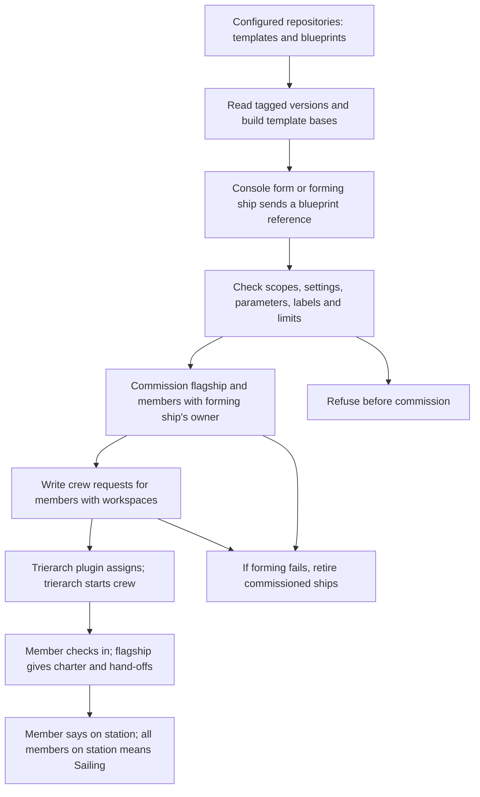

# Asking for a ship by what it does

## Proposed purpose

A person asks for a ship by what it does, gives it a request, and gets a ship that is crewed and starts on that request without the person arranging how it runs.

This is for a business user. Templates describe the work available to ask for. Some are single, with at most one ship of that template at a time in a fleet; others are multiple, with one ship per request. These are the needs in [#41](https://github.com/ThomasHendrickx/aeolus-fleet-squadrons/issues/41), not an agreed implementation or an ownership rule.

## Lessons to check against

1. **Start with the person's work.** The person should not need to choose a blueprint, assemble hand-offs, supply a workspace or paste a crew line to get started. Today's forming flow needs those parts supplied by files or the forming actor. Hiding a developer form would leave that work with the person.
2. **Keep core content-blind and ship-agnostic.** Core commissions ships, enforces scopes and reach, keeps crew requests and delivers messages. It does not interpret a business request, select work or coordinate execution. Squadrons already owns templates, blueprints and forming, in its own process and database (0017). Any proposed change to that boundary needs an explicit question, not an assumed exception.
3. **Build on the template that actually runs.** Templates are versioned files in configured repositories. A base is built into a complete template with a recorded chain; forming keeps a snapshot. A template, a template version, a ship type and a squadron role are different concrete parts. Today's role count and role type belong to one squadron, so neither establishes the fleet-wide single-template guarantee.
4. **Permission to ask and the ship's powers are separate.** Today `squadrons:form` permits forming, and template scopes must be held by the forming ship, checked again by core through `ownerOf`. This is no per-template permission to ask. A scope says what an actor may do, while network rules say where. Receiving a request through a plugin does not grant its sender new rights (0046, 0057).
5. **Ownership answers accountability, not who happened to ask last.** A ship has one owner, a person ship or argo; questions, gates and trouble go there (0045). Today squadrons uses the forming ship's owner. A single ship serving several people makes that existing default a design question. The asker, the owner and other people using the ship must not silently become interchangeable. Argo is the fail-safe, not the normal destination for work.
6. **Reach must be explicit.** Owners reach their ships; replies have a built-in route; squadron members reach one another through declared rules. Asking for a shared ship does not by itself give lasting send, read or manage reach, or access to another person's request. Meetings can let invited participants converse, but do not decide ownership or settle conflicting requests (0034, 0061).
7. **Commissioned, crewed and started are different facts.** A workspace enables today's crew request; the trierarch plugin assigns it and a trierarch starts a session. A member then checks in, receives its charter and says it is on station. `crew.firstPrompt` is first-start only. Neither commission nor a crewed status proves that the person's request reached the crew or that work began.
8. **A retry must keep the person's request.** Today's form stores its answer per forming ship and key; core separately makes commission and send repeatable. Forming retires ships it commissioned when a step is refused. The new flow must account for simultaneous asks, lost answers, partial forming and restarts without losing a request or creating a second single ship. Message acknowledgement proves receipt, not completion of the requested work (0040).
9. **Single does not settle conflicting work.** One exclusive crew lease does not establish how two people's incompatible requests are handled. Ordering, refusal, cancellation and who may steer the ship need answers before an implementation can claim to serve both people.
10. **Keep a person's entry outside the admin console.** People act through their accounts and person ships in their app, chat or gateway; core's console is for fleet administration (0043, 0054, 0057). Where the person asks and what they can discover need to fit that existing boundary. Discovery today describes reachable ships and types, not templates that do not yet have ships (0047).

## How it works today

The [squadrons documentation](../../squadrons.md) describes this existing path, not a proposed flow for asking for a ship:

- A template contains charter, check-in interval, hand-offs, parameters, scopes, labels and optional crew settings. A blueprint chooses versioned templates, role counts and hand-off bindings. A base changes how a template is built, not how a person requests work.
- Forming by message requires `squadrons:form`, a blueprint reference and a key. Members formed this way require workspaces and are crewed by crew requests; secrets never travel in these messages.
- The flagship relays between members and the forming ship. A retired forming ship's owner takes its place under the existing scopes. This is not yet a route for several independent askers to a single ship.
- Limits bound squadrons per fleet, squadrons per forming ship and members per squadron. They do not impose at most one ship of a template across a fleet.
- Existing template scopes describe powers granted to members. They do not identify which people may ask for which templates. The issue's access premise therefore needs clarification rather than a claim that per-template access exists today.

## Approval boundary

The purpose is proposed. No detailed decisions are made here. Questions with options and a pick follow only once the purpose is agreed: the six topics in #41, plus request delivery and recovery, template versions and bases for a single ship, its lifetime, crew readiness, and what the person sees when starting fails.

## Sources

- [Issue #41, including Thomas's words](https://github.com/ThomasHendrickx/aeolus-fleet-squadrons/issues/41).
- [Templates, bases, blueprints, forming and check-in](../../squadrons.md).
- [Squadrons boundary, ownership and forming](../../decisions/0017-squadrons-package.md).
- [Fleet blueprint: purpose, owners, commission, scopes, network, crew requests and meetings](https://github.com/ThomasHendrickx/aeolus-fleet/blob/main/docs/blueprint.md).
- [Fleet decisions index](https://github.com/ThomasHendrickx/aeolus-fleet/blob/main/docs/decisions/README.md), especially 0017, 0026, 0029, 0034, 0040, 0043, 0045, 0046, 0047, 0050, 0053, 0054, 0057 and 0061.
- [Public core calls available to squadrons](https://github.com/ThomasHendrickx/aeolus-fleet/blob/main/docs/compatibility.md).
