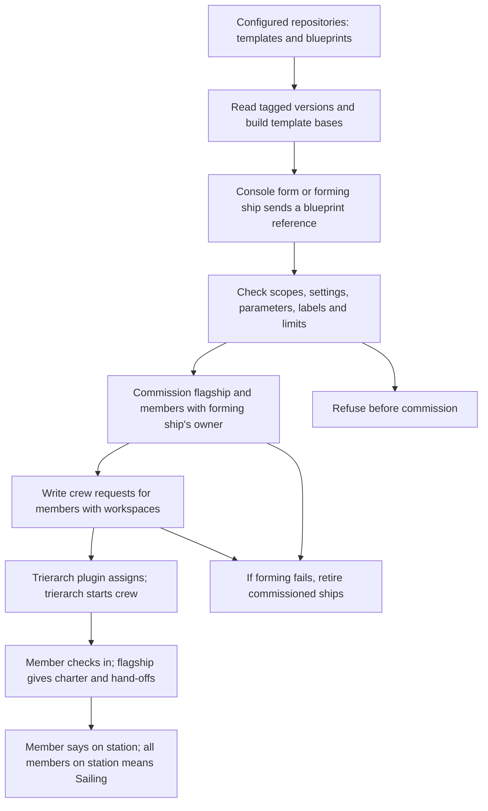
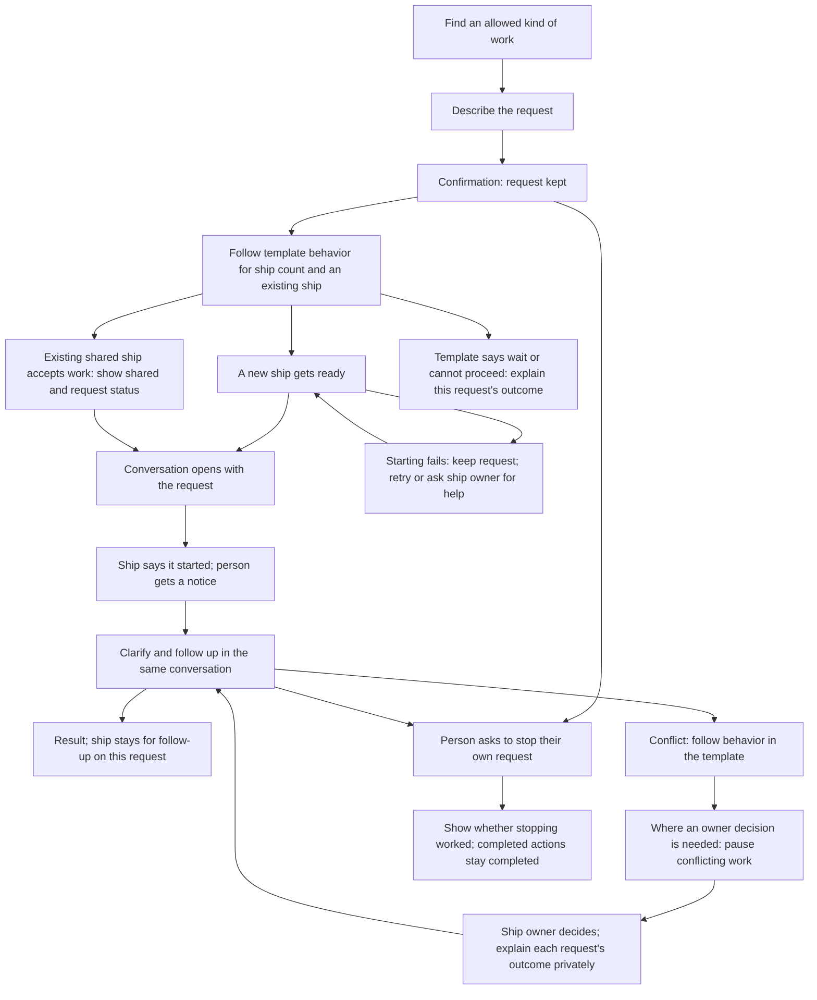

# Asking for a ship by what it does

## Approved purpose

A person asks for a ship by what it does, gives it a request, and gets a ship that is crewed and starts on that request without the person arranging how it runs.

This is for a business user. Templates describe the work available to ask for. Some are single, with at most one ship of that template at a time in a fleet; others are multiple, with one ship per request. These are the needs in [#41](https://github.com/ThomasHendrickx/aeolus-fleet-squadrons/issues/41), not an agreed implementation or an ownership rule.

Thomas approved this purpose, option 1. His direction, verbatim:

> We do need to look at this from the user experience, not technical. UX first, and technical follows after that.

## Lessons to check against

1. **Start with the person's work.** The person should not need to choose a blueprint, assemble hand-offs, supply a workspace or paste a crew line to get started. Today's forming flow needs those parts supplied by files or the forming actor. Hiding a developer form would leave that work with the person.
2. **Keep core content-blind and ship-agnostic.** Core commissions ships, enforces scopes and reach, keeps crew requests and delivers messages. It does not interpret a business request, select work or coordinate execution. Squadrons already owns templates, blueprints and forming, in its own process and database (0017). Any proposed change to that boundary needs an explicit question, not an assumed exception.
3. **Build on the template that actually runs.** Templates are versioned files in configured repositories. A base is built into a complete template with a recorded chain; forming keeps a snapshot. A template, a template version, a ship type and a squadron role are different concrete parts. Today's role count and role type belong to one squadron, so neither establishes the fleet-wide single-template guarantee.
4. **Permission to ask and the ship's powers are separate.** Today `squadrons:form` permits forming, and template scopes must be held by the forming ship, checked again by core through `ownerOf`. This is no per-template permission to ask. A scope says what an actor may do, while network rules say where. Receiving a request through a plugin does not grant its sender new rights (0046, 0057).
5. **Ownership answers accountability, not who happened to ask last.** A ship has one owner, a person ship or argo; questions, gates and trouble go there (0045). Today squadrons uses the forming ship's owner. The person requesting a ship's existence owns it; the template has a separate owner who defines its behavior. The asker, the owner and other people using the ship must not silently become interchangeable. Argo is the fail-safe, not the normal destination for work.
6. **Reach must be explicit.** Owners reach their ships; replies have a built-in route; squadron members reach one another through declared rules. Asking for a shared ship does not by itself give lasting send, read or manage reach, or access to another person's request. Meetings can let invited participants converse, but do not decide ownership or settle conflicting requests (0034, 0061).
7. **Commissioned, crewed and started are different facts.** A workspace enables today's crew request; the trierarch plugin assigns it and a trierarch starts a session. A member then checks in, receives its charter and says it is on station. `crew.firstPrompt` is first-start only. Neither commission nor a crewed status proves that the person's request reached the crew or that work began.
8. **A retry must keep the person's request.** Today's form stores its answer per forming ship and key; core separately makes commission and send repeatable. Forming retires ships it commissioned when a step is refused. The new flow must account for simultaneous asks, lost answers, partial forming and restarts without losing a request or creating a second single ship. Message acknowledgement proves receipt, not completion of the requested work (0040).
9. **Single does not settle conflicting work.** One exclusive crew lease does not establish how two people's incompatible requests are handled. The template owner supplies behavior for the ship count, an ask while one exists and conflicting requests; Aeolus does not choose that behavior.
10. **Keep a person's entry outside the admin console.** People act through their accounts and person ships in their app, chat or gateway; core's console is for fleet administration (0043, 0054, 0057). Where the person asks and what they can discover need to fit that existing boundary. Discovery today describes reachable ships and types, not templates that do not yet have ships (0047).

## How it works today

The [squadrons documentation](../../squadrons.md) describes this existing path, not a proposed flow for asking for a ship:

- A template contains charter, check-in interval, hand-offs, parameters, scopes, labels and optional crew settings. A blueprint chooses versioned templates, role counts and hand-off bindings. A base changes how a template is built, not how a person requests work.
- Forming by message requires `squadrons:form`, a blueprint reference and a key. Members formed this way require workspaces and are crewed by crew requests; secrets never travel in these messages.
- The flagship relays between members and the forming ship. A retired forming ship's owner takes its place under the existing scopes. This is not yet a route for several independent askers to a single ship.
- Limits bound squadrons per fleet, squadrons per forming ship and members per squadron. They do not impose at most one ship of a template across a fleet.
- Existing template scopes describe powers granted to members. They do not identify which people may ask for which templates. The issue's access premise therefore needs clarification rather than a claim that per-template access exists today.

## Approved experience

### 1. Find and ask

The person picks from a list of kinds of work described in everyday words, then describes the request. They do not arrange how the ship runs.

### 2. Wait and return

The person gets confirmation that the request is kept, sees "getting ready" or "started", and gets a notice when work starts. They can leave and come back. If starting fails, the request stays and they are told what they can do.

### 3. Work in a conversation

The conversation opens with the person's request. The ship says it started, asks for clarification there and gives the result there. Ready is never shown as started.

### 4. Bespoke and shared ships

A template can define bespoke ships, unique per request and never shared. A template can instead allow at most one ship in a fleet. Its owner writes what happens when someone asks while that ship already exists. Aeolus does not choose that behavior.

When the template's behavior lets a person give an existing shared ship work, the person is told it is shared and whether their request started or waits. Nobody sees other people's conversations.

Thomas's note, verbatim:

> Type of ship can define that it should always be bespoke, so unique per request. Then those are never shared.

### 5. Conflicting requests

The template owner writes the behavior for handling conflicts in the template. Where that behavior calls for an owner's decision, the conflicting work pauses and the ship's owner decides. Each affected person is told privately; neither sees the other's request. Work that does not conflict keeps going. This is behavior on the ships, not native conflict policy in core.

Thomas's note on conflict policy, read with the template clarification in question 10, verbatim:

> Can be also set as a policy / rule on a ship by the owner (not natively in aeolus core) on how to handle conflicts

### 6. Follow up and stop

The person can follow up, clarify or stop their own request. They cannot change other people's work or end a shared ship. Stopping shows whether it worked, never that completed actions were undone.

### 7. Who may ask

People see the kinds of work their organisation has allowed them to ask for; the rest is not shown. Being allowed to ask is separate from what the ship itself may do. The organisation sets both.

### 8. Ship ownership and template ownership

The person requesting a ship's existence owns that ship, shared or not. A shared ship does not need an owner named beforehand. The template has its own owner, who manages how ships made from it act; that person need not own those ships. Everyone can see who answers for a ship. Clarifications about a request stay in that person's conversation.

The option requiring the organisation to name a shared ship's owner beforehand does not apply.

Thomas's notes, verbatim:

> A ships owner is the one requesting it's existence. A template (or whatever we call it) also has a template owner.

> No wrong, a shared ship does not need an owner up front. Shared or not still the one requesting it was the owner. What I said was that a template also has an owner. Example if I have a template called Baker, the template owner can be mike as he is the one managing the template that defines how the ship should act. Becky requested a baker ship so she will be the owner of that ship. Frans also requests a baker ship so frans as well is the owner of a baker ship.
> 2 ships with 2 different owners and Mike still is owner of the baker template.
>
> Come back with new questions if needed.

### 9. Asking when the allowed ship already exists

How many ships are allowed and what happens when someone asks while one exists are behavior the template owner writes in the template. Aeolus does not choose between giving work to an existing ship, waiting, refusing or making another ship. The template's stated limit and behavior govern the case. The Baker example distinguishes ship ownership from template ownership; it does not itself specify that template's limit.

Thomas's answer to revised question 9, verbatim:

> Again I don't get the question. If it is defined in the template that there can max be one, than this conflict is resolved through a rule in that template.

### 10. Where conflict behavior belongs

Approved option 2: conflict behavior is captured in the template, set by the template owner for every ship of it. An individual ship's owner cannot change it. There is no separate ship-owner policy editor or conversation command proposed here.

Thomas's note, verbatim:

> This is behaviour captured in the template

### 11. Explain waiting and decisions privately

Approved option 2: give a reason about the person's own request, such as waiting to start or waiting for the owner's decision. After a decision, say whether the request continues, keeps waiting or cannot go ahead. Reveal nothing about anyone else's request and promise no times.

### 12. Retry or get help when starting fails

Approved option 1: try again with the kept request, or ask the ship's owner for help from it. Show whether a retry is under way. The person need not describe the request again.

### 13. Follow up after bespoke work ends

Approved option 2: the conversation and ship stay for follow-up on that request. Different work gets a new bespoke ship. Conversation history stays as long as the fleet keeps it. Completing or stopping work does not itself retire the ship or release its crew.

Thomas's note, verbatim:

> Retiring a ship or releasing a crew are active actions the user asks for.. or the agent the user is using offcourse

### 14. Who settles a conflict on a single ship

The template's behavior governs this case too. Where it hands a decision to an owner, that is the ship's owner, not automatically the template owner. The design does not choose a conflict policy for the template owner to follow.

## What the template can state

The template owner supplies the behavior for:

- how many ships may exist, including a bespoke ship per request or at most one in the fleet;
- what happens when someone asks while the allowed ship already exists;
- how conflicting requests are handled, including whether a case needs the ship owner's decision.

These describe work and behavior the template owner fills in. They do not define new fields, a policy language or a native core feature.

## The person's journey

### Happy paths

A person chooses an allowed kind of work, describes the request and gets confirmation it is kept. Where the template calls for a new ship, the person requesting its existence owns it. It gets ready without that person arranging how it runs. The person can leave and return, gets a start notice and continues in a conversation opening with the request. Clarifications and the result belong there.

Where the template accepts work on an existing single shared ship, another person gives it their own request. They see that the ship is shared and whether their work waits or starts. The conversation remains private. Asking for work on an existing ship is not itself a rule for changing that ship's owner; behavior for an ask while one exists comes from the template.

For bespoke work, the ship and conversation stay available for follow-up on that request. Different work gets a new bespoke ship. History follows the fleet's retention. Retiring the ship or releasing its crew requires an active request from the user or their agent.

### Unhappy paths and returning to the work

| Situation | What the person sees and does |
| --- | --- |
| Starting fails | The request stays. Try again from it or ask the ship's owner for help; see whether a retry is under way. It is not shown as started. |
| A single ship already exists | The template's rule determines what happens. Explain whether this person's request waits, starts or cannot go ahead, without exposing another person's request. |
| Two requests conflict | Follow the template's conflict behavior. Where it needs the ship owner's decision, pause conflicting work and tell affected people privately. Non-conflicting work continues. Explain each person's own outcome without promising times. |
| The ship needs clarification | The person answers in the conversation containing their request. |
| The person leaves before work starts | Return to the kept request and its current status; get a start notice when work starts. |
| The person wants to stop | Ask to stop their own request and see whether it worked. Other people's work and the shared ship are not ended. Completed actions are not presented as undone. |
| The person wants work they are not allowed to ask for | That kind of work is absent from their choices. No access-request flow is proposed here. |

## Approval boundary

The purpose, UX direction and experience answers above incorporate Thomas's ownership correction and his direction that template owners supply ship-count, existing-ship and conflict behavior. The journey follows those answers without choosing that behavior for a template. No API, data or squadrons/core placement design is proposed in this round. Implementation design and implementation approval remain separate.

## Sources

- [Issue #41, including Thomas's words](https://github.com/ThomasHendrickx/aeolus-fleet-squadrons/issues/41).
- [Templates, bases, blueprints, forming and check-in](../../squadrons.md).
- [Squadrons boundary, ownership and forming](../../decisions/0017-squadrons-package.md).
- [Fleet blueprint: purpose, owners, commission, scopes, network, crew requests and meetings](https://github.com/ThomasHendrickx/aeolus-fleet/blob/main/docs/blueprint.md).
- [Fleet decisions index](https://github.com/ThomasHendrickx/aeolus-fleet/blob/main/docs/decisions/README.md), especially 0017, 0026, 0029, 0034, 0040, 0043, 0045, 0046, 0047, 0050, 0053, 0054, 0057 and 0061.
- [Public core calls available to squadrons](https://github.com/ThomasHendrickx/aeolus-fleet/blob/main/docs/compatibility.md).
