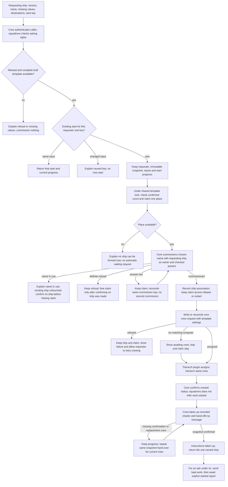

# Start one ship: detailed design

Issue [#33](https://github.com/ThomasHendrickx/aeolus-fleet-squadrons/issues/33), following the [approved purpose and five decisions](stage-1.md). Those decisions govern this design. Thomas answered the seven detailed-design questions on 20 November, one card each. The decisions below remain dependent on the named core contracts. This document approves no implementation, commission, scope grant or rollout.

## Request and result

A requester is the authenticated ship asking for the new ship: a person ship, an agent or an app. For an authenticated account, core must establish the account's person ship. The new ship belongs to that requesting ship. An app calling for itself owns the ship; an app presenting a checked account identity must not silently become that account's requester. Payload fields cannot choose a different actor or owner.

The request names one configured repository, template name and tagged version, the chosen ship name, the parameters still open after building its bases, the missing values needed to crew it and every declared hand-off destination. The template supplies charter, scopes, labels, crew settings and check-in interval. The ship's type is the template name; squadrons keeps repository and version identity separately. The type grants no reach. There is no blueprint, squadron id, role, extra flagship or role override layer. Optional overrides beyond filling missing values are not proposed. Missing or invalid required values are explained before commissioning; no invented workspace or model fills a gap.

The result distinguishes accepted start, ship commissioned, crew requested, crewed, and instructions taken up. A direct start carries no business-work request. It never reports that work started merely because the ship is crewed. #41 adds a kept work request and its explicit started report above this forming operation.

**Entry:** expose the start and its progress through squadrons operations behind core's authenticated plugin-call transport. Procedure names and wire schemas belong to implementation after approval. A caller knows its start key before submitting. Squadrons checks the verified actor and the template's required asking rights, independently of the approved powers the ship will receive. No scope or owner claimed in message content is trusted. No new screen is selected by this design; a person-facing entry returns for experience design if requested.

## Flow from request to crewed ship

Every box after acceptance resumes from durable progress.

A name preflight can improve feedback but is never a name reservation. Core's active-name uniqueness decides simultaneous commissions. An accepted retry reconciles its recorded commission first, even if its name is now in use by the ship that start made. A request to choose another name after a definite conflict is a new submission with a new key; editing an accepted start in place is not proposed. Unknown outcomes must be resolved before a new submission is offered as a replacement.

## Squadrons, core and crew

| Part | Responsibility |
| --- | --- |
| Squadrons | Build and pin the complete template and base chain; validate missing values and hand-offs; check asking rights; keep starts, snapshots, progress, shared claims and ship associations; resume commissioning, crew requests and instruction hand-over. It interprets no business instruction to invent count policy. |
| Core | Authenticate the actor; enforce its generic scopes, ownership, name uniqueness and reach; commission repeatably; keep crew requests and deliver opaque messages. No template, start or count tables move into core. |
| Trierarch plugin and trierarch | Assign and start the existing crew request with the template's settings, then restart or wake the crew under the normal lease contract. Squadrons starts no local agent process. |
| Requested ship | Take up the snapshot and destination bindings before acting. A destination supplied by the requester gives no new send, read or manage reach. Crew status and instruction confirmation remain separate facts. |
| Requesting ship | Own the new ship and receive its result and trouble under the eventual approved core ownership contract. The template owner governs the template, not the new ship's ownership. |

**Hand-offs:** The caller chooses exactly one selector for each declared destination: a ship id, a ship name, or a label. Keep that chosen selector as the binding in the snapshot and hand it to the crew. Reach still decides each send; naming a destination grants no reach. Thomas's note was:

> Both of them.
> Only is means retiring a destination ship potentially breaks a whole setup.
> But that behaviour might be tmwhat they want .. so we give the caller the choice to identify by id, name, label (only 1 of these)

**Instruction hand-over:** use #41 proposal 29 for this same single-ship primitive. Squadrons sends the kept built charter, substituted parameters and direct bindings as an ordinary message, receives a confirmation tied to that ship and snapshot, and only then allows #41's work message. A replacement crew takes up the instructions again. The first prompt helps the crew find the messages and preserves the template's first-start instructions; it holds neither the only charter nor the only request. The hand-over must be bound to the current core lease, with obsolete confirmations ignored. Core's documented ship reads do not yet establish a sufficient current-lease identifier for this protocol; core must confirm that contract or add it before this guarantee can be built. A timestamp or a delivery acknowledgement alone is not proof of the current crew's confirmation. No squadron check-in or flagship is fabricated. Whether direct ships periodically report to squadrons is outside the approved task; existing template reporting instructions remain in their charter.

## State, repeatability and recovery

Proposed storage is fleet-scoped in squadrons' database. A start records the actual requester, key and input digest; built hash and complete snapshot; selected name, parameters and hand-offs; creation and crew-request steps with stable core keys; resulting ship id; and instruction confirmation. The unique start lookup is fleet plus requester ship plus start key. Same content answers the recorded start; changed content under that key is refused. Start-key retention and the exact outcome API return for contract design before implementation; this document promises no arbitrary expiry.

The shared count record and claim are the ones in [#41](../asking-for-a-ship/asking-for-a-ship.md#count-across-every-version-and-forming-path) and [#43](../template-count-changes/template-count-changes.md#6-a-confirmation-racing-with-in-flight-claims), not another direct-start counter. Accepting a request is not itself permission to commission. Claim and the decision to create commit together before the core call. Core calls run outside the local count lock. A pending commission retains its place; a crew release, disconnected plugin, finished work or restart frees nothing. Only confirmed failed commission or confirmed retirement frees it. Index starts by fleet/requester/key, associations by fleet/ship and claims by fleet/repository/template. All processes serving that fleet use the same database coordination.

| Failure or race | Required result |
| --- | --- |
| Two starts choose one name | Core accepts at most one. Explain the other's name conflict without changing the existing ship. |
| Same accepted start submitted twice | One start and creation step; return the same ship and progress. Check the recorded start before interpreting its own commissioned name as a conflict. |
| Template changes after acceptance | Continue the kept build and inputs. A moved tag never changes that start or silently selects another approval. |
| One direct start and one blueprint or #41 ask compete | Same count and claim transaction. No second counter, per-version allowance or partial blueprint claim. |
| Count lowered after a claim commits | That claim continues. A later claim sees the new confirmed count. No ship is retired to fit. |
| Commission answer lost, plugin restarts | Resume the same commission key and keep the claim while unknown. Never free it merely because a ship lookup failed. |
| Crew request answer lost | Reconcile the same ship's intended crew request through the documented core request/read contract. Do not commission again or replace it with changed settings. |
| Crew request refused after commission | Keep the ship and count claim, show the failure and let the requester explicitly retry crewing that ship. |
| No matching computer | Keep awaiting crew with the reason. No false success or count release. |
| Destination later retires or send is refused | Keep the chosen selector and surface send failure; reach decides each send. No charter hand-off is reported as completed if its delivery fails. |
| Crew released or replaced | Ship and claim stay. Re-establish the same instructions for the current crew under Q3; release is not retirement. |
| Name available after an earlier ship retired | A new id is a different ship. Earlier messages and starts stay associated with the old id. |

## Core calls and gaps

Contract checked against aeolus-fleet [docs/compatibility.md](https://github.com/ThomasHendrickx/aeolus-fleet/blob/588e69d6abbef76cab684c9d0367cb9aaf30f488/docs/compatibility.md). These are allowed contracts or explicitly named dependencies, not claims that every release has them.

| Need | Documented core contract | Boundary or missing part |
| --- | --- | --- |
| Authenticated start/progress entry | `POST /api/v1/fleet/callPlugin`, common/plugin-server, core/common 0.42.0 | Generic transport exists. Squadrons must expose and verify its own operation context and persist dispatch reservations. Domain start keys outlive the transport request id. No automatic transport retry implies success. |
| Actor and template-right check | Verified plugin context for Q1; `fleet/ship` for existing ship reads | `ship/whoami` identifies squadrons, not its requester. A message's scope array proves nothing. Account-to-person-ship resolution must be documented by core; #1771 remains a separate identity prerequisite where that checked mapping is needed. |
| Read ship/name and crew progress | `fleet/ship`, `fleet/list` | Use exact lookups and necessary fields. The plugin's broad read reach is not requester visibility or permission. These are not name locks or substitutes for current-lease proof. |
| Commission and rights | `fleet/commission`; `fleet/approveCommission`, `fleet/withdrawCommissionApproval`, `approval: { approvalId, subjectDigest }` and `ownerOf`, gated on the release carrying core #1745 | The recorded approval remains valid until withdrawn and binds one exact built template; core checks it at commission. A changed build needs a new approval. `ownerOf` copies the named ship's owner; it does not make that agent or app the new owner. |
| Request and reconcile crew | `fleet/crewRequest`, `fleet/ship`; `fleet/removeCrewRequest` only for an approved explicit operation | Preserve the template's settings and use common schemas. No automatic removal or release follows a timeout. Existing repository-workspace shapes require the release carrying core #1760. |
| Deliver and confirm instructions | `ship/send`, `ship/receive`, `ship/ack`; `fleet/ship` for crew status | The ordered hand-over is approved. Current-lease identification sufficient to reject old confirmations needs confirmation or addition to the public contract. `ack` proves receipt only. |
| Template labels | `fleet/defineLabel`, `fleet/labels`, `fleet/findLabelValue`, `fleet/assignLabel` as needed under existing label ownership | Existing labels remain checked. A direct ship has no fake `squadron` label. The approved direction extends 0017's owned label and declared manage rule to ships squadrons directly forms; the core contract requires its own approval. |
| Destination reach | Core checks `ship/send` | No new reach call or automatically granted rule. `fleet/declareNetworkRules` is listed, but no new rule is authorised by choosing a hand-off. |
| Reconcile explicit retirement | `fleet/ship` | `fleet/retire` and `fleet/release` are listed but this start operation invokes neither as an assumed cleanup decision. |

**Core lacks the approved ownership behavior.** [0045](https://github.com/ThomasHendrickx/aeolus-fleet/blob/588e69d6abbef76cab684c9d0367cb9aaf30f488/docs/decisions/0045-owners.md) currently limits owners to person ships or argo and copies the requester's owner through `ownerOf`, even with a rights approval. #33 requires the requesting ship itself, including an agent or app. This is a core design dependency under 0045, with any necessary 0017/0046 and compatibility amendments. Do not substitute its human owner, change ownership afterward or reopen Thomas's answer. Core must design the generic ownership representation, lifecycle and resulting reach/questions contract before implementation. The orchestrator must carry this gap to core; no existing call is misrepresented as sufficient here.

**Squadrons lacks approved manage reach for a direct ship.** Decision 0017's label rule covers squadron members. Direct ships need core's normal manage check for crew requests. Thomas chose to extend squadrons' owned label and declared manage-rule scheme to ships it directly forms, restricted to ships squadrons forms. The core design and contract need their own approval; this grants no destination reach.

Every first use of a newer core contract raises `MINIMUM_CORE_VERSION` in the same implementation PR, to an actual released version recorded in compatibility. No guessed version or internal core import is permitted.

## Fit with #43 and #41

#43's confirmed count is keyed by fleet, configured repository and template name, independent of version or built hash. Derived templates have their own identities. Direct starts, #41's individual asks, blueprint members and later-added members all record that identity before commission. A blueprint claims all its required places or none under the same locks. A direct start adds a visible forming-path value to #43's explanation where the reader may see it; hidden ships remain only "A ship you can't see". Request content stays private. Ship owners are the actual requesting ships under #33's correction; the template owner remains the separately appointed person ship and alone decides a count change.

Lowering keeps all ships, owners, snapshots and claims, including uncertain commissions. Raising durably offers new places to existing waiting requests oldest first through that same claim. An explicit direct start with no place explains that no ship can be formed now and creates no automatic waiting request; it has no count exemption. Queue admission and the race between new starts and existing waiting offers must be specified together before implementation rather than introducing a second allocation path.

#41 uses this one-ship forming primitive when its approved flow needs a new ship. It additionally owns the business request, case interpretation, conversation, work send and explicit started report. Direct starting is not permission to reuse an existing shared ship or submit business work to it. Thomas approved #41 proposals 27, 28 and 29 on 20 November. Proposal 27 is needed for template cases in #41, not for a straightforward direct start with a free place. Proposal 28 governs the recorded approval for one exact build until withdrawn. Proposal 29 is the shared ordered hand-over. The requester-as-owner correction needs propagation into #41's person-only passages in its own design change, not an unannounced edit on this branch.

## Slices and proof before release

These are proposed build boundaries after the required core designs and contracts are approved, one thin PR per slice. Production changes require a separate test commit ending `(red)` before code; only the affected tests run locally, with CI judging the rest.

1. **Contracts and ownership, core first.** Settle the requesting-ship owner gap and lease proof, publish common schemas and compatibility. Secure approval for the 0017 direct-ship manage contract and resolve the checked account mapping. No direct-start release before these contracts can express the approved behavior.
2. **One shared count and association.** Associate existing template-formed ships before enforcement. Prove direct, blueprint and #41 claims against one confirmed count, all-or-none blueprint allocation, lowering races, uncertain outcomes, explicit retirement and release. This is shared work with #43, not a direct-only implementation.
3. **One durable start to one commission.** Validate a built snapshot and inputs, authenticate the requester, use the shared claim and commission the exact name. Prove duplicate/changed keys, simultaneous names, two actors, two fleets, lost answers and restart. No crew or business-work success is claimed in this slice.
4. **Crew and instruction hand-over.** Use existing crew requests and the approved Q3/Q4 recovery. Prove no matching computer, refused/lost request, crew replacement and obsolete confirmation. Check the actual charter, parameters and chosen id, name or label selectors received by the crew, rather than just its status.
5. **#41 integration and any approved entry experience.** Reuse this operation without creating a second ship or count claim. Prove instructions before work and an explicit work-start report. If a screen is then selected, design before/after mockups and loading, empty, refusal, partial and lost-answer states before implementation.

Design against 3,000 ships and 10 million messages per fleet. Exact start and ship lookups and the count rollup use indexed current state, never a fleet or message-history scan. Progress reads target p95 below 100 ms, p99 below 500 ms and errors below 1%, measured when built. Lists, if exposed, use database cursors with 20 rows per page. No performance result is claimed by this document. Walk the exact release candidate through commission, actual crew instructions and recovery before release.

## Decisions answered 20 November

Thomas answered one card per question. Q1 and Q3 to Q7 were option 1; Q2 was his own choice, quoted above.

1. Use core's authenticated plugin-call transport and the template's asking rights.
2. Bind each hand-off to exactly one caller-chosen ship id, ship name or label; reach decides each send.
3. Use #41 proposal 29's ordered message hand-over, confirmed by the current crew before work.
4. On crew-request failure, keep the ship and count claim, show the failure and let the requester retry crewing.
5. When no place is available, explain that no ship can be formed now; create no automatic waiting request.
6. Use the template name as the ship type.
7. Extend 0017's owned label and declared manage rule to directly formed ships, restricted to ships squadrons forms. The core contract needs its own approval.
