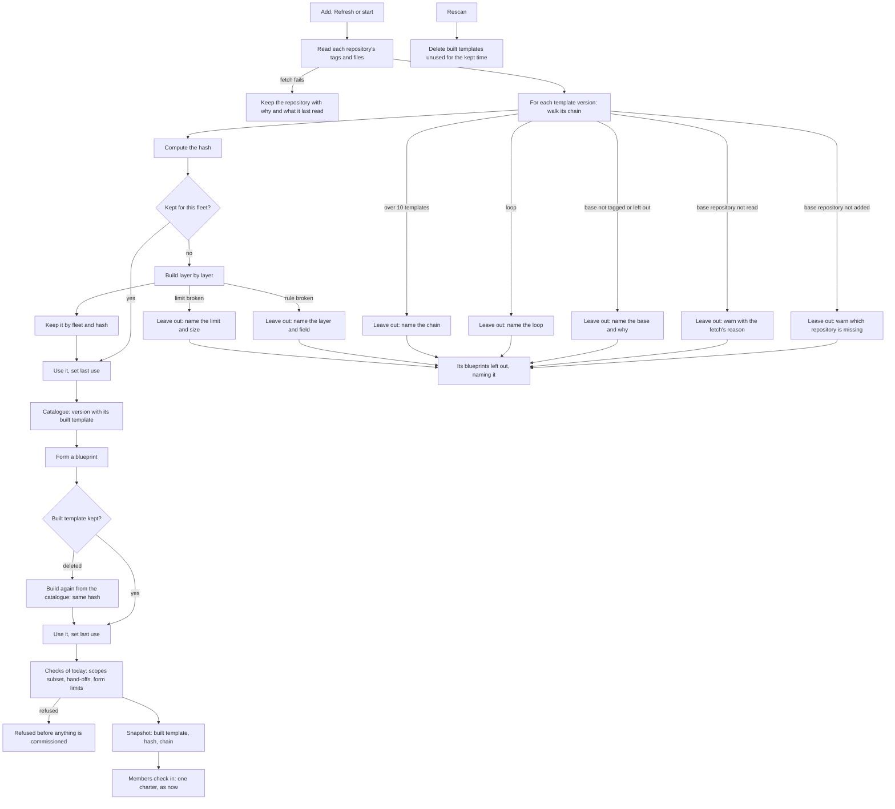

# Template bases: stage 2, decisions and design

Issue: [aeolus-fleet#1311](https://github.com/ThomasHendrickx/aeolus-fleet/issues/1311).

## Purpose

Thomas, 26 Oct 2026: "it would be nice if we can make ship templates like Docker images are made. So you take a base image and then you apply some modifications on it, and that creates in itself again another image which can be then used in another template by a base as a base image. [...] some additions to it, some replacements, some filling in of parameters, whatever. [...] We could really elevate on the philosophy of how Docker images are made, and still keep it simple." And on 27 Oct: "Ok let's design the ship templates in the image of [Docker] images."

**The problem.** Today a ship template is one whole file ([Ship template](../../squadrons.md#ship-template)). Every template that shares behaviour with another (how a ship reports to its lead, how it asks the owner, how it commits) carries its own copy of that text. A fix to the shared part is copied by hand into each template, and the copies drift: the same problem Thomas solved for skills by making them installable, and for templates by sharing them from ThomasHendrickx/skills.

**What it is for.** Thomas, and anyone writing templates for a fleet, writes a shared part once, as a template, and a more specific template names it as its base and states only what differs: what it adds, what it replaces and which parameters it fills. Thomas's example: an Aeolus base ship template, an implementer template on it, a TypeScript implementer on that; reviewers likewise.

**A good outcome.**

- A template names one base template version and adds to it, replaces parts of it, or fills its parameters. The result is a template version like any other: a blueprint role runs it, and another template can name it as its base.
- A squadron still forms from one complete template per role and never changes afterwards, as now ([Files in git](../../squadrons.md#files-in-git), Snapshots).
- A person reading a template, or a squadron in the console, can see what the role's ships finally get and which template version each part came from.
- Nothing changes for a template without a base, nor for a blueprint, nor for a member at check-in: the role message carries one charter, as now.

**What it must not become.** Thomas asked to keep it simple. So no build language: no conditionals, no loops, no instructions that run when a later template builds on this one (Docker's `ONBUILD`), no template with two bases, no `{{name}}` syntax beyond what parameters already are, and no version ranges or "latest". The fleet and core learn nothing of it: it lives in squadrons alone (decision 0017), and it needs no newer core.

## Lessons to check against

### Docker

| Docker | How it works | Fit for ship templates |
| --- | --- | --- |
| `FROM image:tag` | A Dockerfile names one base image; everything after it builds on that. One base per stage. | Good: a template names one base template version. |
| The result is an image | A built image is itself a base for the next `FROM`. Any image runs, a base or not. | Good: a template with a base is a template version like any other. Every template stays formable: decision 8. |
| Layers | Each instruction adds a layer over the ones below; a file deleted in a later layer still sits in the one below, so nothing is truly removed. | Partly: a template is text and fields, not files, so it can replace a part outright. Nothing is removed: decision 3. |
| `ENV`, `LABEL` | Per key, the later value wins; the rest of the base's keys stay. | Good: matches crew settings today, nearest wins per field, `options` per key ([Crew settings](../../squadrons.md#crew-settings)). |
| `CMD`, `ENTRYPOINT` | The last one wins whole; there is no "add to the base's command". | The charter is the closest thing: added after the base by default, replaced whole when stated: decision 1. |
| `ARG` | A build value, given at build time; an `ARG` of the base is gone once the base is built, and a child declares its own to use one. | Good: a template filling its base's parameters bakes the value in, as a build value does. A filled parameter is final: decision 2. |
| `ONBUILD` | Instructions a base sets to run when a child builds on it. Widely found confusing; Docker's docs warn against surprises. | Bad: left out. |
| Tags and digests | A tag (`node:20`) can be moved to another image; a digest (`@sha256:...`) never changes. Reproducible builds pin by digest. | Good: a version is the tag `<name>@<n>`, which is not to be moved ([Step by step](../../squadrons.md#step-by-step), step 2), and squadrons records each version's commit, its digest. A moved tag is used silently, as `alpine:latest` is: decision 10. |
| A new base does not reach children | A child image keeps the base it was built on until it is built again; tools such as Renovate open pull requests to bump `FROM`. | Good with a price: a squadron never changes, but a fix in a base reaches a child only through a new child version: decision 4. |
| `docker history`, `docker inspect` | `inspect` shows the final configuration, `history` each layer and the instruction that made it. | Good: the console shows the resolved template, and the chain of bases it came from: decision 6. |
| Layer limit | An image holds at most 127 layers. | A limit on how deep a chain may go: 10, decision 5. |
| Build cache | A built layer is kept by the hash of what made it and reused until pruned. | Good: a template version is built once into its full template, kept by its hash: [Build and hash](#build-and-hash). |
| Multi-stage builds, `COPY --from` | Take parts from several images into one. | Bad: two bases is what Thomas's "keep it simple" rules out. |

### This codebase

- **Versions are exact tags.** A blueprint names a template as `<repository>#<name>@<n>`, a tag that exists, never a branch or a commit; letter case must match the repository's name ([Squadron blueprint](../../squadrons.md#squadron-blueprint), [Common mistakes](../../squadrons.md#common-mistakes)). A base reference can take the same form.
- **The snapshot.** Forming stores the blueprint version and every template version it uses, as read then, in the squadron's `templates` (`packages/squadrons/src/adapters/prisma/schema.prisma`, `Squadron.templates`). Adding a member later reads the squadron's own snapshot, not the catalogue (`packages/squadrons/src/core/squadron/add-member.ts`). Older snapshots without newer fields are read with defaults (`squadron-repository.ts`), so a new field must keep old snapshots readable.
- **The catalogue knows every version.** squadrons reads every tag `<name>@<n>` of every configured repository and keeps what it read per commit ([Template repositories](../../squadrons.md#template-repositories)). A base is then already in the catalogue when it is in a configured repository: resolving needs no more GitHub calls. A version that cannot be read is left out with why, and that is where a missing or wrong base would show.
- **Parameters.** A template declares each parameter and uses it as `{{name}}` in its charter and first prompt; an undeclared placeholder is refused. A blueprint role fills them, then the form per member, nearest wins; one left unfilled stays as written. Each value is at most 1 KB, and a charter at most 48 KB, a first prompt at most 8 KB once filled, so the role message stays within 64 KB (#371). A chain grows the charter: the 48 KB limit holds for the resolved one.
- **Crew settings.** Template, then blueprint role, then form: each field the nearer one sets replaces the farther's whole, except `options`, which merge per key; the model only in `crew.model`. A base adds one more layer below the template.
- **Scopes and hand-offs.** A template's scopes are granted within the subset rule, and forming refuses any other before commissioning anything (decision 0017). A blueprint binds exactly the hand-offs its templates declare.
- **One tag reads both folders.** The tag `<name>@<n>` reads `templates/<name>.yaml` and `blueprints/<name>.yaml` at its commit; a template and a blueprint of one name collide. Base templates follow the same naming.
- **Shared templates.** ThomasHendrickx/skills holds shared templates in `squadrons/templates/`, configured with `path: squadrons`, tagged `designer@1` beside the skills' own `v3.x` tags, which squadrons ignores (ThomasHendrickx/skills#23). An Aeolus base ship template would live there too.
- **The designer template.** [designer.yaml](https://github.com/ThomasHendrickx/skills/blob/main/squadrons/templates/designer.yaml) is the clearest case of shared text: about half its charter (report to the lead over the fleet, never ask in the terminal, invent no vocabulary, say each thing once) applies to any ship, not only to a designer.

## Decisions

Thomas agreed the purpose as written and answered the stage 1 and stage 2 questions on 27 Oct 2026.

1. **The charter.** A template's charter is added after its base's; the template may instead replace its base's charter whole, stated in the file. A part a template should change is a parameter of the base, which the template fills.
2. **Parameters and crew settings.** A parameter a template fills is final: it is no longer a parameter of that template, and neither a blueprint nor a form sees it. A parameter left open stays open, and the template may declare its own. Crew settings merge base, template, blueprint role, form: nearest wins, `options` per key.
3. **The other fields.** `checkIn` and `launchNote` a template sets replace its base's; `handoffs` and `scopes` only add, none is removed. Every template has its own `description`.
4. **The base reference.** One exact version, as a blueprint names one: `<repository>#<name>@<n>`.
5. **The depth.** Thomas: "Lets pick 10 instead of 5, we'll see what that gets us." A chain holds at most 10 templates, the template itself included; a loop is refused.
6. **The snapshot.** Each role's template as built, plus its chain. Thomas: "It is the list of bases build on top", base-layer-0 first:
   ```
   <base-layer-0>
   <base-layer-1>
   <base-layer-2>
   ...
   ```
7. **Where bases live.** Any repository the fleet configured. Thomas: "When loading the templates, squadrons checks if it has access to all required templates (bases included). If not it gives a warning why that template cannot be included and what repository is missing."
8. **Every template is complete and formable**, a base too.
9. **Built once, kept.** Thomas: "important --> full template gets build and hashed based on the version. They are kept for x amount of time. Else calculating it every single time from scratch becomes hard, same as the docker images that get build each deploy." A template version is built once into its full template, identified by a hash, and kept; forming and reading use the built one. A built template is kept 30 days since last used.
10. **A moved version tag.** A tag is not to be moved, but if it is, squadrons uses its new commit silently, with no warning. Thomas: "I would keep 3 .. if someone wants to change it .. It is the same as using alpine@latest in docker ... it changes, deal with it. You need to trust the basis you use. That is not aeolus to concern about. If this becomes an issue, we will deal with it later." The hash follows the commit, so a moved tag builds to a new hash, and no squadron changes.
11. **A change of the build rules.** The hash also covers a build rules number, which squadrons raises when a rule of [Building](#building) changes. A changed rule builds anew. Thomas: "indeed we are not yet 1.0".

## Design

### The file

A template names its base in one field, `base`, shaped as a blueprint role is: a reference and the values it fills.

```yaml
# templates/typescript-implementer.yaml
base:
  template: github.com/ThomasHendrickx/skills#implementer@2
  parameters:
    language: TypeScript
description: Implements a slice in a TypeScript repository
crew:
  model: claude-opus-5-5
charter: |
  Run npm run typecheck before every commit.
```

| Field | Required | Rule |
| --- | --- | --- |
| `base.template` | yes, with `base` | `<repository>#<name>@<n>`: a repository the fleet configured, a template's name and a version tagged in it. Only tags, letter case exact, as a blueprint's reference |
| `base.parameters` | no | Values for parameters the base leaves open, by name, each at most 1 KB. A name the base does not leave open is refused, naming the parameters it does |
| `base.replaceCharter` | no | `true`: this template's `charter` replaces its base's whole, and is then required. Left out: the charter is added after the base's |

With `base`, only `description` is required: `checkIn` and `charter` come from the base unless the template sets them. Without `base`, a template is as today, and nothing about it changes.

### Building

Building a template version walks its chain from base-layer-0, the template without a base, up to the version itself, and applies each layer over the full template below it:

| Part | Rule per layer |
| --- | --- |
| `charter` | Added after the charter below, one blank line between; replaced whole with `base.replaceCharter: true` |
| `base.parameters` | Each value is filled into the charter and `crew.firstPrompt` below; the parameter is then no longer the template's |
| `parameters` | The layer's own, added to those left open below. A name already a parameter below, open or filled, is refused |
| `description`, `checkIn`, `launchNote` | Set: replaces the one below. `description` is never taken from below |
| `handoffs` | Added. A name already declared below is refused |
| `scopes` | Added; one already below is kept once |
| `crew` | Each field set replaces the one below whole, `options` per key, as a blueprint role does over a template |

A placeholder in the layer's own text must be a parameter of the full template at that layer, open or filled by that layer; any other is refused, as today. The full template then holds what a template without a base holds, and every check of today runs on it: the limits, the subset rule for scopes at forming, the blueprint binding exactly its hand-offs.

### Build and hash

A version is built once, when the catalogue is read: at a repository's add, at Refresh and at start. Building needs no more GitHub calls, since every base is a version of a configured repository and read with it.

- **The hash** is the SHA-256 of the build rules number and the chain, base-layer-0 first: for each layer its repository, name, version, commit and the SHA-256 of its file's text. One chain under one build rules number gives one hash, and one hash one built template.
- **Kept** in Postgres, per fleet (`fleet_id` and hash), with the chain, the full template, which layer each charter part and field came from, when it was built and when it was last used. A fleet never finds another fleet's built template, so a base read with one fleet's token never reaches another.
- **Looked up first.** Reading the catalogue computes each version's hash and takes the kept one when there is one; it builds and keeps only what is missing. Two reads building one hash at once keep one: the same chain builds the same template.
- **Used.** The catalogue, the console and forming read the built template, never the files again. Each use sets its last use.
- **Deleted** once unused for 30 days, on a fleet's rescan. A version still in the catalogue whose built template was deleted is built again at its next use, from what the catalogue read, to the same hash and the same template. Deleting a fleet forgets its built templates with the rest.

### The catalogue's warnings

A version that cannot be built is left out of the catalogue, and Settings shows it under its repository with why, as a version left out today. Its blueprints are left out too, naming it.

| Case | Shown |
| --- | --- |
| A base in a repository the fleet has not configured | "typescript-implementer@1 cannot be included: its base github.com/ThomasHendrickx/skills#implementer@2 is in github.com/ThomasHendrickx/skills, which this fleet has not added. Add it under Settings, Repositories." |
| A base's repository configured but not read (its fetch failed, a private one without a token that reads it) | Names the base, its repository and the fetch's reason |
| A base at no tag, or a version not tagged | Names the reference, as a blueprint's |
| A base left out itself | Names the base and its reason; a chain left out low leaves out every version above it |
| A loop | Names the loop: "a@2 builds on b@1, which builds on a@2" |
| Too deep | "typescript-implementer@1 builds on 11 templates; a chain holds at most 10", with the chain |
| A rule of [Building](#building) broken | Names the layer and the field: a parameter not left open, a name declared twice, an undeclared placeholder |
| A limit broken once built | Names the limit and the full size: a charter over 48 KB, a first prompt over 8 KB, over 20 scopes |

### The snapshot

Forming stores each role's built template in the squadron's `templates`, as it stores a template now, and beside it the hash and the chain, base-layer-0 first, each layer's repository, name, version and commit. Adding a member, the flagship and the role message read the snapshot only, as now; a built template deleted later changes nothing. A snapshot from before bases is read as a chain of one, its own version.

### The console

Wherever a template version shows (Settings, the blueprint's roles, a squadron's roles), it shows its full template, and Built from, its chain base-layer-0 first:

```
github.com/ThomasHendrickx/skills#aeolus-ship@3      4f2a91c
github.com/ThomasHendrickx/skills#implementer@2      9b0c1de
github.com/tidewater-labs/squadron-templates#typescript-implementer@1   e77a020
```

Each charter part and each field set by a layer is marked with that layer's version, so a reader sees which version gave what.

### Flow



## Scenarios

### How big

- **Given** a chain of 10 templates, base-layer-0 to the template, **when** the catalogue is read, **then** the template is in the catalogue with its full template and a chain of 10.
- **Given** a chain of 11, **when** the catalogue is read, **then** the 11th is left out, saying it builds on 11 templates and a chain holds at most 10, and every layer below it stays.
- **Given** three layers whose charters are 20 KB each, **when** the catalogue is read, **then** the top one is left out: its charter is 60 KB once built, over 48 KB. The two below stay.
- **Given** a built charter of 48 KB with a `{{area}}` left open, **when** a form fills `area` past 48 KB, **then** forming is refused before anything is commissioned, naming the member, as today.
- **Given** a base with 15 scopes and a template adding 6 others, **when** the catalogue is read, **then** the template is left out: 21 scopes, over 20.

### Who may

- **Given** a template in the fleet's own repository whose base is in ThomasHendrickx/skills, which the fleet added, **when** the catalogue is read, **then** it is built and in the catalogue.
- **Given** a base in a private repository added by fleet A with a token, **when** fleet B, which has not added it, reads a template on that base, **then** B's template is left out, saying which repository is missing, and B finds nothing A built.
- **Given** a ship holding `squadrons:form`, **when** it forms a blueprint whose role's template has a base, **then** it is formed as any other: bases add no scope and no new check of who may form.

### What when it fails

- **Missing base:** **Given** `implementer@3` names `aeolus-ship@4`, which is not tagged, **when** the catalogue is read, **then** `implementer@3` is left out naming the reference, and so is every blueprint naming it.
- **Missing repository:** **Given** a base in github.com/ThomasHendrickx/skills, which the fleet has not added, **when** the catalogue is read, **then** the template is left out with a warning naming that repository and saying to add it under Settings, Repositories.
- **Loop:** **Given** `a@2` names `b@1` and `b@1` names `a@2`, **when** the catalogue is read, **then** both are left out, each naming the loop.
- **Too deep:** as under How big.
- **Unreadable version:** **Given** `aeolus-ship@3` is invalid YAML, **when** the catalogue is read, **then** it is left out with why, and each template on it is left out naming `aeolus-ship@3` and its reason.
- **Rule broken:** **Given** a template whose `base.parameters` fills `lead`, which its base already filled, **when** the catalogue is read, **then** it is left out, saying `lead` is not a parameter its base leaves open, and naming those that are.
- **A fetch fails:** **Given** the base's repository was read before and its next fetch fails, **when** the catalogue is read, **then** the repository keeps what it last read, and the template stays as built from it.

### The guarantees

- **A squadron never changes.** **Given** a squadron formed from `typescript-implementer@1` on `implementer@2`, **when** `implementer@3` is tagged, or the base's repository is removed, or its built template is deleted, **then** a member added later gets the charter the squadron formed with, read from its snapshot.
- **A version means the same as long as its tag is not moved.** **Given** `typescript-implementer@1` built to hash H, **when** the catalogue is read again, after a restart, or after H was deleted, **then** it builds to H and the same full template.
- **A moved tag.** **Given** `implementer@2` was built from commit 9b0c1de, **when** its tag is moved to 3a7f210 and the catalogue is read, **then** the version is built from 3a7f210 to a new hash, with no warning, and a squadron formed before keeps its snapshot.
- **A changed build rule.** **Given** `typescript-implementer@1` built to hash H, **when** a later squadrons raises the build rules number, **then** it builds anew to another hash H2, and a squadron formed before keeps its snapshot.
- **A fix in a base reaches only new versions.** **Given** `implementer@3` fixes `implementer@2`, **when** the catalogue is read, **then** `typescript-implementer@1` still builds on `implementer@2`, and only a `typescript-implementer@2` naming `implementer@3` gets the fix.
- **Built once.** **Given** H is kept for the fleet, **when** the catalogue is read or a squadron formed, **then** nothing is built again and the last use of H is set.
- **One build per hash.** **Given** two reads of one catalogue at once, **when** both build H, **then** one built template H is kept, and both use it.
- **Nothing changes without a base.** **Given** a template without `base` and a snapshot from before bases, **when** the catalogue is read and a member added, **then** both behave as today, the snapshot read as a chain of one.
