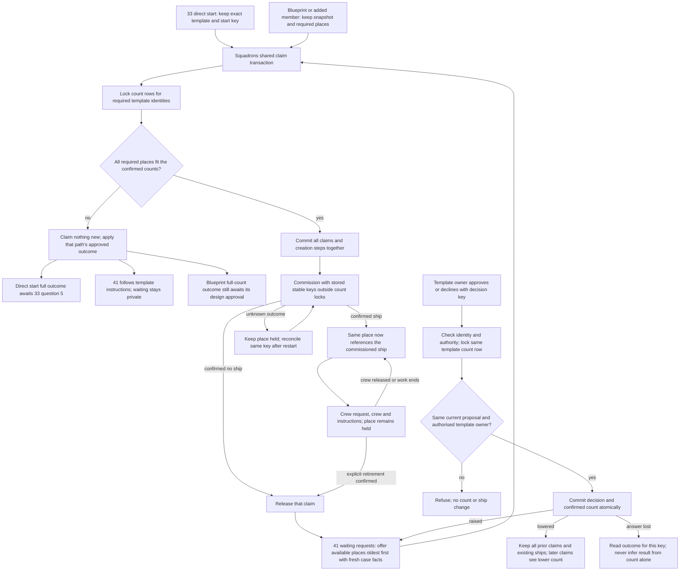

# One template count, including direct starts

Integration for [#43](https://github.com/ThomasHendrickx/aeolus-fleet-squadrons/issues/43), following the [three approved integration decisions](stage-1.md#approved-integration-decisions). The [approved count design](template-count-changes.md) and [API and identity decisions](api-and-identity.md) govern. The [#33 detailed design](https://github.com/ThomasHendrickx/aeolus-fleet-squadrons/blob/design/33-start-one-ship-stage-1/docs/design/start-one-ship/detailed-design.md) adds the named direct-start path and has its own open questions. No behavior, pending dependency or implementation is approved by this check.

## The same identity and held places

One count belongs to one fleet, configured repository identity and template name. Its version, built hash, base chain, chosen ship name, owner and forming path do not open separate places. A derived template has its own template identity, not its base's identity. A non-template ship does not count. The flagship has no template and does not consume a member-template place.

Each forming path keeps the template identity, exact version and built snapshot with its ship association and creation claim before commission:

| Path | Places claimed | What remains different |
| --- | --- | --- |
| #33 direct start | One, before commissioning the chosen name | No blueprint or flagship. The requester supplies missing values and direct hand-offs. No business request is implied. |
| #41 individual ask | One when its template instructions call for a new ship | An existing ship receiving another request consumes no new place. Keep the request, case outcome and private conversation. |
| Blueprint forming | Every required member place, all or none before any member commission | Keep the blueprint snapshot, flagship and squadron check-in. No partly admitted blueprint evades the count. |
| Add blueprint member | The added member's place before commission | Keep the existing squadron. Do not recount existing members as new claims. |

Held places include confirmed, unretired ships and creation steps whose commission result is unknown. A confirmed ship and its creation step describe one place, not two. Commission success turns that existing claim into the ship association; it does not increment another counter. Crew release, no matching computer, completed work or a restart leaves the place held. Confirmed retirement or confirmed failed commission frees it. Existing template-formed ships must be associated and uncertain creation attempts reconciled before enforcement is enabled for their template. Otherwise the count would start by ignoring them.

The new ship's owner is the ship that asked for it, whether a person ship, agent or app, under Thomas's #33 correction. The template owner is the appointed person ship authorised to change the count. These are different roles. A template-owner decision changes neither ownership nor the ships' requests, crew, snapshots or bespoke/shared kind.

## Four paths through one count

The direct-start and full-blueprint unhappy outcomes are named dependencies, not new product decisions here. Neither may commission without a place. Waiting requests already have the approved oldest-first offer flow; how #33's no-place choice integrates with admission of new starts must be settled there before building an allocator.

## Ordering and uncertain outcomes

Count confirmation and place claiming take the same per-template lock. The local transaction contains only squadrons state; no core network call holds that lock. For a blueprint requiring several templates, the proposed transaction takes those locks in one stable identity order. The #41 shared-count proposal requires all places or none. A stored creation key is used outside that transaction for commission. Core and squadrons have no cross-database transaction.

| Concrete race or failure | Outcome required by the approved design |
| --- | --- |
| Limit 3, held 2; direct claim commits, then owner confirms 1 | The third claim continues, even if commission has not answered. All three count. New claims see 1 and cannot commission. No rollback is performed to meet the lower number. |
| Same facts; confirmation commits before the direct claim | The direct claim sees 1 with 2 held and cannot obtain a place. Existing ships keep working. #33's open no-place choice decides the explanation/retry flow. |
| Limit 1; direct start and #41 new-ship ask race | At most one claims the place. The other follows its path's no-place outcome. A new version or different requester cannot bypass the claim. |
| Blueprint needs two places; only one is free | No partial claim or member commission. Its full-count product outcome remains a #41 dependency; it is not silently turned into a queued #33 start. |
| Limit raised while waiting requests exist | Commit the count and durable offer work. Offer waiting requests oldest first, reapply their recorded template instructions with fresh facts and use the same claim. If the case ship is unavailable, keep that request visibly waiting; do not guess its instructions. |
| Process dies after raise, before offering | Resume kept offer work. A retried offer finds its existing request/claim and never allocates a second place. |
| Commission succeeds but its answer is lost | Keep its claim and stable key until reconciled. Do not count it twice or free it based on a failed lookup. Lowering in the meantime preserves it. |
| Crew request fails or no computer can crew | The ship still exists and holds its place. #33's crew-failure recovery choice does not let #43 infer retirement. |
| Explicit release, then explicit retirement | Release frees nothing. Only confirmation of retirement frees the place and enters the existing waiting-offer flow. |
| Owner approves, answer is lost, then a different count is confirmed | Query the original decision key. The current count alone proves neither the first decision nor its absence. |
| A late decide arrives after an outcome read says not written | The closing outcome transaction has closed that key under the same lock; the late decide is refused `KEY_CLOSED`. |
| A new tag appears, is moved or disappears during a decision | Apply the approved current-proposal/version/commit checks and refuse stale decisions. The confirmed count never silently follows a tag. |
| Ship belongs to an agent or app requester | It holds the same place. Only the appointed template owner may decide the count. Core ownership support is a #33 prerequisite, not a second count or a reason to omit the ship. |

A decrease never converts a bespoke ship to shared. Counts and capacity are facts; an existing-ship or conflicting-work outcome remains the template's instructions, interpreted by the approved case mechanism when available. The count page neither reads nor chooses that business policy.

## Owner explanation and screens

The already approved page lists held places with version and forming path, within the reader's reach. A directly started ship is labelled as a direct start alongside an individual ask or blueprint member. It is not made into a fake squadron row. An unknown commission remains a creation in progress and counts. The owner shown is the actual requesting ship under #33; a person ship is not substituted for an agent or app.

A ship outside the reader's reach stays "A ship you can't see", with no owner, name, version, forming path or timing. Its place still counts. Waiting is only a number, never anyone else's request. Lowering and raising explanations, confirmation buttons, shared sign-in, failures and decision-key recovery use the existing approved states. The before/after data mockups for the direct-start row are embedded in PR #62, not delivered as external artifacts. They add no new screen layout or control.

At 3,000 ships and 10 million messages per fleet, the page reads the current count rollup and one database-cursor page of 20 held places, with exact indexed identity/claim lookups. It never reads the whole fleet or message history. Core reads only the referenced ship ids, under the reader contract once #1771 is resolved. No request content is included. Keep the existing p95 below 100 ms, p99 below 500 ms and error rate below 1% targets; measurement is required when built, not claimed here.

## Dependency resolutions and remaining contracts

This section closes the design ambiguity about who owns each dependency and how it connects. It does not declare unresolved approvals complete.

| Dependency | Integration resolution | Still required before the affected slice |
| --- | --- | --- |
| #33 association and count | A direct start records the same template identity and uses the shared claim. Count-page explanations include it under existing reach rules. Thomas approved this integration on 20 November. | Build the common association and claims before enabling any direct-start count enforcement. Resolve #33 question 5's no-place behavior. |
| #41 proposal 27, named case ship | Only the waiting/existing-ship paths that need template interpretation depend on this agent. A count change commits without asking that agent; offer work waits durably if it is absent. The agent cannot claim, approve powers or change a count. | Thomas's approval of proposal 27 and its charter, owner and limited rights. Carry #33's requester-as-owner correction into that design. Do not commission a case ship from this approval. |
| #41 proposal 28, recorded rights approval | The shared allocator claims capacity; core separately checks powers at commission. A changed built hash may require another approval but opens no new count identity. Withdrawal blocks the affected new commission and frees a place only after confirmed no ship. | Thomas's policy choice on lifetime and exact-build binding, core/common contract and release for #1745, compatibility and any 0045/0046 amendments. A compatibility mention is not approval of squadrons' proposed policy. |
| #41 proposal 29, instruction hand-over | Commission and its count claim precede instructions. Direct and #41 formed ships use one agreed hand-over; confirmation never frees a place or means work started. | Thomas's hand-over choice, also returned in #33 question 3; public core proof of the current crew/lease sufficient to reject stale confirmations. No first-prompt-only fallback is assumed. |
| Core #1771 N1, checked identity | The page must get core-checked account/person-ship claims before writing, as approved I1/C1. The plugin's own `whoami` is not that identity. | Core designs and publishes the identity call and common schema. #1771 is open; no call name or signature is invented here. |
| Core #1771 N2 to N4, reader reach | Use only page ship ids with `fleet/list` under the account or on behalf of the checked template owner, then redact outside-reach rows as approved A3b. | Core confirms account-token presentation, `Aeolus-On-Behalf-Of`, the `shipIds` filter and limits in squadrons' compatibility row. `fleet/list` alone in that row does not establish these modes. |
| Core #1771 N5, console session | Argo/viewer entry uses the already designed console-session boundary. | Core corrects the missing squadrons `console.session` compatibility entry. No unapproved partial rollout follows from that correction. |
| #33 requesting-ship ownership and manage reach | Count accepts agent/app owners without substitution; template-owner decision authority remains the appointed person ship. Crew requests still need core manage reach. | Core resolves 0045's current person-or-argo-only owner model and `ownerOf` copying the requester's owner. #33 question 7 resolves restricted direct-ship manage reach under 0017. Neither blocks writing a count design, but both block the affected direct-start implementation. |
| Existing full-blueprint proposal in #41 | Required member places are all or none. A count change cannot partially admit a squadron. | The proposed immediate refusal at full count remains for approval. No queue or new behavior is added by this document. |

For core, the existing read is `fleet/ship` for O1's template-owner status, and `fleet/list` for the referenced ship page once #1771's modes are confirmed. Commissioning, crew requests, send/receive/ack and any retire read are the calls in [compatibility](https://github.com/ThomasHendrickx/aeolus-fleet/blob/588e69d6abbef76cab684c9d0367cb9aaf30f488/docs/compatibility.md), as enumerated in #33's core-call table. `templateCount.read`, `decide` and `outcome` in [the approved API design](api-and-identity.md#decisions-one-write-one-answer) belong to squadrons, not core. No core endpoint manages a template count.

Core must publish the required calls, semantics and common schemas, then update compatibility with actual releases. Squadrons raises `MINIMUM_CORE_VERSION` in the first implementation PR using them. The app entry, shared sign-in and console's existing approved link remain separate work. Their presence does not approve a rollout without the identity/reach contract.

## Build slices and evidence

No implementation starts merely because this stage is written. The existing design's approvals remain the authority; unapproved parts above return to their own design owners. After the needed approvals:

1. **Common association and count claims.** Use one fleet/template rollup, associate existing ships and reconcile unknown commissions. Connect direct starts, blueprint forming and #41 creation to the same claim. Prove all-or-none multi-template claims, version independence, claim/confirm races, restart and retirement versus release.
2. **Count read and decision transaction.** Implement the already approved API and identity behavior after core #1771. Prove current-template-owner checks, fleet isolation, a decision's exact version/commit, key reuse, lost answers and closing-outcome races. Keep account and reader reach authoritative.
3. **Durable waiting offers.** Persist the count change and offer work together. Prove raise/restart, duplicate offers and fresh claim checks, with the approved case ship and instructions only once their design is approved. Preserve waiting oldest-first; no direct-start exemption or new queue policy is introduced.
4. **Approved page and entries.** Use the existing screens and shared sign-in contracts, with direct-start data in the existing row. Prove hidden-ship redaction, no request-content leak and known refusal versus unknown decision outcome. Walk before/after data at the approved desktop and phone sizes.
5. **Integrated release walk.** On the exact candidate to publish, start directly, form a squadron, lower below held places, release without freeing, explicitly retire, raise with waiting requests, lose a commission answer and lose a count-decision answer. Verify actual crew instructions and private outcomes as well as page numbers. No partial rollout or automatic lifecycle action is implied.

Each production slice begins with a separate failing-test commit ending `(red)`, then implementation. Run only its touched tests locally; CI judges the rest. This documentation supplies scenarios, not runtime evidence or a new test process.

## Questions remaining before implementation

There is no additional product decision introduced by this integration check. The following existing choices remain unapproved; they are listed in full to make the dependencies actionable. The picks are proposals, not decisions.

1. **Existing #41 proposal 27: should the fleet enable one named ship to handle template cases before the requested ship exists?** Options: (1) enable `squadrons-requests` with the charter in #41, owned by the ship requesting its existence under #33's correction, crewed through a normal request using fleet-supplied harness, exact model and workspace, with only sending/receiving rights; squadrons supplies case facts and checks outcomes; (2) have the requester supply an existing agent ship, retaining its existing owner and crew, with squadrons checking outcomes. **Pick: 1**, because it gives waiting cases one visible responsibility without giving the agent count or commissioning authority.
2. **Existing #41 proposal 28: should a recorded rights approval remain usable until explicitly withdrawn and bind one exact built template?** Options: (1) an authorised granter records a bounded approval for squadrons and that exact build; core checks it at every new commission; withdrawal blocks new commissions without changing existing ships; a changed build requires new approval; (2) also recheck the approver's live rights at every new commission, blocking after rights loss even without withdrawal. **Pick: 1**, because the bounded grant and withdrawal are explicit and no long-lived account token must be retained.
3. **Existing #41 proposal 29, also #33 question 3: should the one ship take up its template instructions by message before receiving work?** Options: (1) send the kept charter and bindings, wait for confirmation by the current crew, then send the work request; replacement crew repeats the hand-over and the first prompt is not the only copy; (2) return with another restart-safe hand-over design before building. **Pick: 1**, because one recorded hand-over serves both direct starts and asks without a flagship. Core must still establish the current-lease proof.
4. **Existing #41 full-blueprint proposal: what happens when the whole blueprint cannot claim its required places?** Options: (1) refuse before any member commission, naming the templates without enough places, keeping existing squadron behavior and adding no implicit queue; (2) design a durable whole-blueprint waiting flow before building it. **Pick: 1**, as proposed in #41, because it preserves all-or-none forming without inventing another waiting contract.

The seven #33 questions stay on [its detailed design](https://github.com/ThomasHendrickx/aeolus-fleet-squadrons/blob/design/33-start-one-ship-stage-1/docs/design/start-one-ship/detailed-design.md#new-questions), rather than being reopened here. Core #1771 and the ownership/lease gaps need core design work and compatibility publication, not a pretend approval of unspecified APIs. No merge, build or rollout approval is requested by this document.
