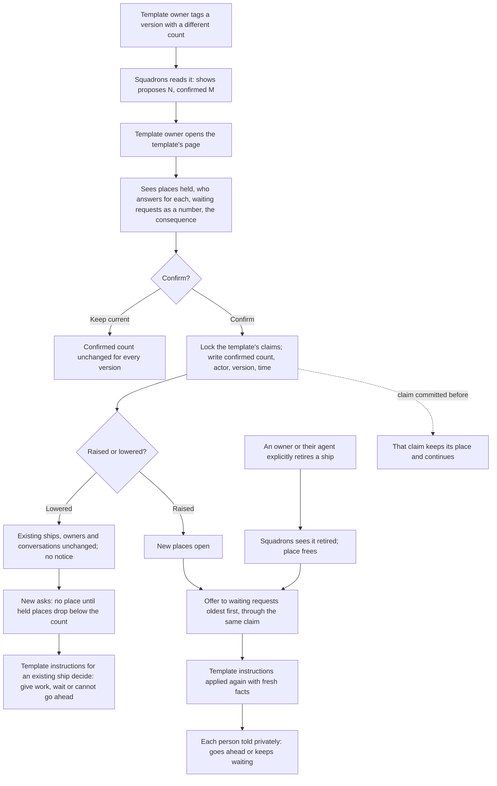

# Changing a template's ship count while ships exist

Issue: [#43](https://github.com/ThomasHendrickx/aeolus-fleet-squadrons/issues/43). Builds on [Asking for a ship by what it does](../asking-for-a-ship/asking-for-a-ship.md) ([#41](https://github.com/ThomasHendrickx/aeolus-fleet-squadrons/issues/41), [#42](https://github.com/ThomasHendrickx/aeolus-fleet-squadrons/pull/42)).

Everything below is a proposal for Thomas's approval. Nothing here is approved, and nothing is built, commissioned, retired or granted by this document.

## Proposed purpose

A template owner can raise or lower how many ships a template allows while ships of it exist. Before confirming, they see what the change does. People keep using the ships they have, and new requests follow the confirmed count.

What it is for, in the issue's words: "a clear outcome for the people using those ships and the template owner." A good outcome:

- The template owner sees the ships that hold places, who answers for each, and what the new count means, before anything changes. They confirm it or keep the current count.
- A person using an existing ship notices nothing: their conversation, follow-ups and ship stay as they are.
- A person asking after the change gets the outcome the confirmed count and the template's instructions give, explained privately.
- No count change retires a ship or releases a crew. Only an explicit request from the user, or the agent the user is using, does that.

What it must not become: a way to retire other people's ships, a per-version count, a core policy, or a rule that whichever version was asked for last sets the count.

## Lessons to check against

These are what the recorded answers and today's code already fix. The questions below must fit them.

1. **One count per template, across versions and forming paths (answer 25).** The count identity is the fleet, the configured repository and the template name, without the version. A new version opens no second place. Ships made outside templates are not counted.
2. **The count is an enforced setting in the template (answer 15).** The template file carries it, and squadrons enforces it. Other behaviour, such as what happens when someone asks while the allowed ships exist, is instructions the template owner writes. Aeolus chooses neither.
3. **The template owner is set by the fleet (answer 16).** The fleet sets them when it makes the template available. Whoever tags a version in git is not by that fact the template owner. So a version tag can carry a new count that the template owner has not seen yet.
4. **Squadrons claims a place before it commissions (answer 20).** Claims include confirmed ships and creation attempts whose outcome is uncertain. They survive a restart and a crew release. A place frees only once squadrons sees the ship retired, or confirms that a failed commission made no ship.
5. **Retiring and releasing are active requests (answer 13).** Thomas: "Retiring a ship or releasing a crew are active actions the user asks for.. or the agent the user is using offcourse." The person requesting a ship's existence owns it (experience 8). The template owner manages how ships of the template act, not those ships' lifecycle.
6. **Nobody sees other people's requests (experience 4, 11).** An outcome is explained about the person's own request only, with no promised times.
7. **Today's code has no fleet-wide count.** Today's limits are `SQUADRONS_PER_FLEET`, `SQUADRONS_PER_FORMING_SHIP`, `MEMBERS_PER_SQUADRON` and a role's `count` inside one blueprint ([Limits](../../squadrons.md#limits)). They are checked before commission, and no claim table exists yet. A count change therefore has nothing to migrate, but it must be designed into the claim from the start.
8. **The #41 design still has open proposals.** Its proposals 27 (the `squadrons-requests` case ship), 28 and 29, and its proposed blueprint refusal at a full count, are not approved in this repository just because #42 merged. This design depends on them only where it says so. It does not change the #41 design or core's commission approval.
9. **Squadrons ids follow decision 0005.** Any new record takes the existing prefixed-id form. Core's prefix list stays core's.

## Questions, options and picks

### 1. How does a count change take effect?

The count lives in the template file (lesson 2), and anyone who can tag the repository can tag a version with another count (lesson 3).

1. A version tag sets the count as soon as squadrons reads it.
2. A version's different count is a proposed count. It takes effect only when the template owner confirms it on squadrons' page. Until then the last confirmed count governs every version.
3. The count moves out of the file into a fleet setting the template owner edits.

**Pick: 2.** The file still states the count (answer 15), and the template owner who answers for the template's behaviour (answer 16) sees and confirms the change, as the issue asks. Option 1 lets a tag change people's outcomes without anyone seeing it first. Option 3 reopens answer 15.

### 2. When versions state different counts, which one governs?

Example: `baker@1` allows 3, `baker@2` allows 1, and both stay in the catalogue.

1. The confirmed count governs every version (follows from question 1, option 2). A version whose count differs from the confirmed one shows as "proposes 1, confirmed 3" until the template owner confirms or keeps the current count.
2. The highest version's count governs.
3. The lowest count among available versions governs.

**Pick: 1.** There is one count per template (answer 25), and it changes only by an explicit confirmation. Options 2 and 3 pick a count by a rule nobody confirmed, and a removed or moved tag would silently change it. If the version that proposed the confirmed count later leaves the catalogue, the confirmed count stays.

### 3. What does the template owner see and confirm?

On squadrons' page for that template, before confirming:

- the confirmed count and the proposed count, with the version that proposes it;
- the places held: each ship's name, who answers for it, the version and forming path it came from (individual ask or blueprint), and whether its place is a confirmed ship or a creation in progress;
- how many requests wait for a place (a number, never their content);
- what changes, in plain words. Lowering: "No ship is retired or released. These N ships keep working for the people who have them. No new ship forms until fewer than M hold places." Raising: "K new places open. Waiting requests are offered them, oldest first."

They confirm or keep the current count. The page shows no other person's request and offers no retire or release button for ships the template owner does not own.

**Pick:** this content, with no options. The alternative of confirming without the list of places would hide exactly the consequence the issue asks for.

### 4. Lowering below the ships that exist

Example: a single template allowed 3, three ships exist, and the confirmed count drops to 1.

1. **Ships stay; the place frees only on explicit retirement.** All three ships keep their owners, requests and follow-ups. No new ship forms until held places drop below 1. A new ask follows the template's instructions for an ask while the allowed ships exist, with the facts of every existing ship. Those instructions might give the work to an existing ship, keep the request waiting, or say it cannot go ahead. The ship owners get no notice: nothing changed for them.
2. As 1, but each owner of a ship over the count gets a notice that the template now allows fewer ships and that retiring is their choice.
3. Over-count ships stop taking new requests and keep only their existing ones.

**Pick: 1.** It keeps every existing ship and conversation as it was, and leaves retirement an active request (answer 13). Option 2 presses owners toward retirement without being asked. If wanted later, it is the template owner's message to send, not squadrons' rule. Option 3 is Aeolus choosing behaviour that answer 9 leaves to the template's instructions.

In all three, a ship keeps the kind it was formed with. A ship formed as bespoke is never shared afterwards, even if the template later allows sharing (experience 4: "those are never shared"). The claim records that kind at formation.

### 5. Raising the count

1. **The new places open at confirmation.** Each waiting request is offered a place, oldest first, through the same claim as a new ask. The template's instructions are applied again with fresh facts. The person is told privately whether their request now goes ahead or keeps waiting.
2. The new places open, and waiting requests stay waiting until each person retries.

**Pick: 1.** A place that frees by retirement and a place opened by raising are the same event, so one path offers it. Option 2 leaves people waiting on a count that already allows them. Applying the instructions again with fresh facts matches the case-handling rule "do not assume an old count remains available". That rule sits in #41 proposal 27, so where the instructions need the case ship, offering a place depends on 27's approval. A request whose case ship is missing or uncrewed stays visibly waiting, as #41 already says.

### 6. A confirmation racing with in-flight claims

1. **Confirming takes the same per-template lock as claiming.** A claim committed before the confirmation keeps its place and continues: its commission goes ahead, and a commission whose outcome is uncertain is reconciled, never retired to fit the new count. A claim after the confirmation sees the new count. A blueprint needing several places claims all of them or none under one count, never a mix of two counts.
2. Confirming waits until no claim of the template is in flight.

**Pick: 1.** It needs no waiting and keeps answer 20's rule that uncertainty never opens a second place. Option 2 can wait for as long as an uncertain commission takes to reconcile.

What a blueprint does when its places do not fit (refuse before commission, as today's limits do) is #41's proposal, not decided here.

### 7. Restart and durability

1. **The confirmed count, who confirmed it, when, and from which version are written in the confirming transaction.** The page shows "confirmed" only after that write. A restart reads the confirmed count and the claims; nothing is recomputed from the catalogue. Offering newly open places to waiting requests is recorded per request, so after a restart it continues where it stopped, and no request gets two places.
2. Keep the confirmed count only in memory and rebuild it from the newest version at start.

**Pick: 1.** Squadrons already rebuilds the catalogue on every start ([Files in git](../../squadrons.md#files-in-git)). A count rebuilt from it would undo the confirmation that question 1 requires.

### 8. Who may confirm, and undoing a change

1. **Only the template owner confirms.** Undoing is another confirmation: keeping the previous count, or confirming a version that states it. Lowering never retires anything, so raising back loses nothing: places open again with no ship action. If the template owner's ship is retired, nobody confirms until the fleet sets a new template owner. The confirmed count meanwhile stays.
2. The template owner or argo confirms.
3. Anyone who can make the template available confirms.

**Pick: 1.** It keeps the template owner accountable for the template's behaviour (answer 16), and gives argo no power that is "argo's alone" (decision 0053). Option 3 mixes making a template available with deciding its behaviour.

The rights the fleet uses to set or change a template owner come from #41 answer 16's own design and are not chosen here. This design needs no new core scope and no core call.

## Flow

## Happy and unhappy paths

| Situation | Outcome |
| --- | --- |
| Lowered below existing ships | Every ship stays, with its owner, crew and conversations. New ships wait for held places to drop below the count. |
| Raised | New places open at confirmation and are offered to waiting requests oldest first. |
| Two versions state different counts | The confirmed count governs both. The page shows the other as a proposal. |
| A new version with the same count | Nothing to confirm. |
| The version behind the confirmed count leaves the catalogue | The confirmed count stays. |
| Confirming while a commission's outcome is uncertain | That claim keeps its place. It is reconciled, never retired to fit. |
| Confirming while a blueprint claims places | The blueprint gets all of its places under one count, or none. |
| Restart after confirming, before offering places | The confirmed count and per-request offers are durable. Offering continues, and no request gets a second place. |
| Restart during the confirmation | Nothing shows as confirmed until the write commits. Either the old or the new count holds, never a mix. |
| Lost confirmation answer | Reading the page shows the confirmed count. Confirming the same count again changes nothing. |
| Someone other than the template owner tries to confirm | Refused, and nothing changes. |
| Template owner's ship retired | Nobody confirms until the fleet sets a new template owner. The confirmed count holds meanwhile. |
| Case ship missing or uncrewed when a place opens | The request stays visibly waiting (depends on #41 proposal 27). |
| A ship formed bespoke when the template becomes shared | It stays bespoke and never takes another person's request. |
| A ship owner explicitly retires or releases | Retiring frees the place once squadrons sees it retired. Releasing frees nothing: the ship still exists. |

These guarantees are to be proven by concurrency, rollback and restart tests when built. Nothing in the package provides them today.

## What this design does not do

- No automatic retirement or crew release, and no retire or release action for the template owner on ships they do not own.
- No per-version count, and no count taken from the version asked for last.
- No change to the #41 design, to core's commission approval or to core's rights. No new core call, and no `MINIMUM_CORE_VERSION` change.
- No choice of what a template's instructions do when the allowed ships exist. That stays the template owner's.

## Sources

- [Issue #43](https://github.com/ThomasHendrickx/aeolus-fleet-squadrons/issues/43) and [issue #41](https://github.com/ThomasHendrickx/aeolus-fleet-squadrons/issues/41).
- [Asking for a ship by what it does](../asking-for-a-ship/asking-for-a-ship.md): approved answers 9, 13, 15, 16, 20 and 25, experience 4, 8 and 11, and open proposals 27 to 29.
- [Squadrons: limits, files in git](../../squadrons.md) and [decision 0017](../../decisions/0017-squadrons-package.md).
- Fleet decisions [0005](https://github.com/ThomasHendrickx/aeolus-fleet/blob/main/docs/decisions/0005-prefixed-ids.md), [0045](https://github.com/ThomasHendrickx/aeolus-fleet/blob/main/docs/decisions/0045-owners.md), [0046](https://github.com/ThomasHendrickx/aeolus-fleet/blob/main/docs/decisions/0046-scope-catalogue.md) and [0053](https://github.com/ThomasHendrickx/aeolus-fleet/blob/main/docs/decisions/0053-nothing-is-argos-alone.md).
