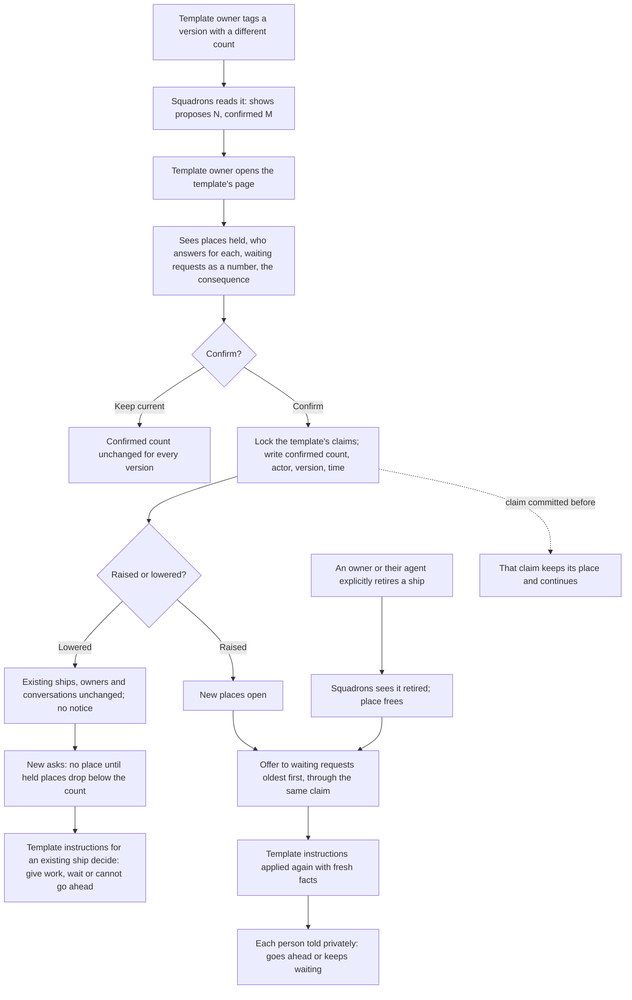

# Changing a template's ship count while ships exist

Issue: [#43](https://github.com/ThomasHendrickx/aeolus-fleet-squadrons/issues/43). Builds on [Asking for a ship by what it does](../asking-for-a-ship/asking-for-a-ship.md) ([#41](https://github.com/ThomasHendrickx/aeolus-fleet-squadrons/issues/41), [#42](https://github.com/ThomasHendrickx/aeolus-fleet-squadrons/pull/42)).

Status: Thomas approved the eight picks below (questions 1 to 8) at commit 334f90b, by answer `msg_01m77aaertnrt09vhrhsbksza9`, option 1, to question `05bacade-47e3-419c-9e36-f35b96206b71`, relayed by the orchestrator ship. That approval covers these picks only. It does not approve the #41 proposals 27 to 29 this design depends on, which stay open. Thomas then approved option 1 of S0, S2 to S5 and D1 to D5 at commit d22c3db, by answer `msg_01m77fega4223kz01z22vez4te`, option 1, to question `d581ade6-230c-447a-bc0c-2beb8fa4aa3e`, relayed by the orchestrator ship. That approval covers those picks only. Thomas then chose S1 option 2, a page Squadrons serves itself, by answer `msg_01m77hn2n2j799h2a2yh2t913v`, option 1, to question `4636b139-8b76-4c84-9fda-61908040bdcf` (request `msg_01m77ffpjg86zjrskgprv1g7ry`), relayed by the orchestrator ship. It keeps the console's read-only rule and decision 0043's plugin-page boundary. Thomas then approved option 1 of S1a, R1, R2, E1, E2 and E3 at commit 83f80f8, by answer `msg_01m77jk21w2tc49qmnbkph249n`, option 1, to question `ac5bd95d-674e-4cf3-a164-c99b1cf816ae` (request `msg_01m77ja4cgg21yhs0y4en0vphh`), relayed by the orchestrator ship. Those picks:
- The template owner stays a person ship, known through a checked core compatibility addition.
- The page is read by a holder of `fleet:read`, or by the identified template owner for that template only.
- Only that owner approves or declines, with no `fleet:manage` and no new scope.
- The console link shows only to those who can read the console today, the switcher only to those its manifest allows, and an owner without `fleet:read` uses a direct link.
- No automatic notice and no ungated entry.

That approval covers these policy picks only. It approves no endpoint, contract or implementation. The exact API and identity design is a proposal in [api-and-identity.md](api-and-identity.md). Nothing is built, commissioned, retired or granted by this document.

## Purpose

A template owner can raise or lower how many ships a template allows while ships of it exist. Before confirming, they see what the change does. People keep using the ships they have, and new requests follow the confirmed count.

What it is for, in the issue's words: "a clear outcome for the people using those ships and the template owner." A good outcome:

- The template owner sees the ships that hold places, who answers for each, and what the new count means, before anything changes. They confirm it or keep the current count.
- A person using an existing ship notices nothing: their conversation, follow-ups and ship stay as they are.
- A person asking after the change gets the outcome the confirmed count and the template's instructions give, explained privately.
- No count change retires a ship or releases a crew. Only an explicit request from the user, or the agent the user is using, does that.

What it must not become: a way to retire other people's ships, a per-version count, a core policy, or a rule that whichever version was asked for last sets the count.

## Lessons to check against

These are what the recorded answers and today's code already fix. The questions below must fit them.

1. **One count per template, across versions and forming paths (answer 25).** The count identity is the fleet, the configured repository and the template name, without the version. A new version opens no second place. Ships made outside templates are not counted.
2. **The count is an enforced setting in the template (answer 15).** The template file carries it, and squadrons enforces it. Other behaviour, such as what happens when someone asks while the allowed ships exist, is instructions the template owner writes. Aeolus chooses neither.
3. **The template owner is set by the fleet (answer 16).** The fleet sets them when it makes the template available. Whoever tags a version in git is not by that fact the template owner. So a version tag can carry a new count that the template owner has not seen yet.
4. **Squadrons claims a place before it commissions (answer 20).** Claims include confirmed ships and creation attempts whose outcome is uncertain. They survive a restart and a crew release. A place frees only once squadrons sees the ship retired, or confirms that a failed commission made no ship.
5. **Retiring and releasing are active requests (answer 13).** Thomas: "Retiring a ship or releasing a crew are active actions the user asks for.. or the agent the user is using offcourse." The person requesting a ship's existence owns it (experience 8). The template owner manages how ships of the template act, not those ships' lifecycle.
6. **Nobody sees other people's requests (experience 4, 11).** An outcome is explained about the person's own request only, with no promised times.
7. **Today's code has no fleet-wide count.** Today's limits are `SQUADRONS_PER_FLEET`, `SQUADRONS_PER_FORMING_SHIP`, `MEMBERS_PER_SQUADRON` and a role's `count` inside one blueprint ([Limits](../../squadrons.md#limits)). They are checked before commission, and no claim table exists yet. A count change therefore has nothing to migrate, but it must be designed into the claim from the start.
8. **The #41 design still has open proposals.** Its proposals 27 (the `squadrons-requests` case ship), 28 and 29, and its proposed blueprint refusal at a full count, are not approved in this repository just because #42 merged. This design depends on them only where it says so. It does not change the #41 design or core's commission approval.
9. **Squadrons ids follow decision 0005.** Any new record takes the existing prefixed-id form. Core's prefix list stays core's.

## Questions, options and approved picks

### 1. How does a count change take effect?

The count lives in the template file (lesson 2), and anyone who can tag the repository can tag a version with another count (lesson 3).

1. A version tag sets the count as soon as squadrons reads it.
2. A version's different count is a proposed count. It takes effect only when the template owner confirms it on squadrons' page. Until then the last confirmed count governs every version.
3. The count moves out of the file into a fleet setting the template owner edits.

**Pick: 2.** The file still states the count (answer 15), and the template owner who answers for the template's behaviour (answer 16) sees and confirms the change, as the issue asks. Option 1 lets a tag change people's outcomes without anyone seeing it first. Option 3 reopens answer 15.

### 2. When versions state different counts, which one governs?

Example: `baker@1` allows 3, `baker@2` allows 1, and both stay in the catalogue.

1. The confirmed count governs every version (follows from question 1, option 2). A version whose count differs from the confirmed one shows as "proposes 1, confirmed 3" until the template owner confirms or keeps the current count.
2. The highest version's count governs.
3. The lowest count among available versions governs.

**Pick: 1.** There is one count per template (answer 25), and it changes only by an explicit confirmation. Options 2 and 3 pick a count by a rule nobody confirmed, and a removed or moved tag would silently change it. If the version that proposed the confirmed count later leaves the catalogue, the confirmed count stays.

### 3. What does the template owner see and confirm?

On squadrons' page for that template, before confirming:

- the confirmed count and the proposed count, with the version that proposes it;
- the places held: each ship's name, who answers for it, the version and forming path it came from (individual ask or blueprint), and whether its place is a confirmed ship or a creation in progress;
- how many requests wait for a place (a number, never their content);
- what changes, in plain words. Lowering: "No ship is retired or released. These N ships keep working for the people who have them. No new ship forms until fewer than M hold places." Raising: "K new places open. Waiting requests are offered them, oldest first."

They confirm or keep the current count. The page shows no other person's request and offers no retire or release button for ships the template owner does not own.

**Pick:** this content, with no options. The alternative of confirming without the list of places would hide exactly the consequence the issue asks for.

### 4. Lowering below the ships that exist

Example: a single template allowed 3, three ships exist, and the confirmed count drops to 1.

1. **Ships stay; the place frees only on explicit retirement.** All three ships keep their owners, requests and follow-ups. No new ship forms until held places drop below 1. A new ask follows the template's instructions for an ask while the allowed ships exist, with the facts of every existing ship. Those instructions might give the work to an existing ship, keep the request waiting, or say it cannot go ahead. The ship owners get no notice: nothing changed for them.
2. As 1, but each owner of a ship over the count gets a notice that the template now allows fewer ships and that retiring is their choice.
3. Over-count ships stop taking new requests and keep only their existing ones.

**Pick: 1.** It keeps every existing ship and conversation as it was, and leaves retirement an active request (answer 13). Option 2 presses owners toward retirement without being asked. If wanted later, it is the template owner's message to send, not squadrons' rule. Option 3 is Aeolus choosing behaviour that answer 9 leaves to the template's instructions.

In all three, a ship keeps the kind it was formed with. A ship formed as bespoke is never shared afterwards, even if the template later allows sharing (experience 4: "those are never shared"). The claim records that kind at formation.

### 5. Raising the count

1. **The new places open at confirmation.** Each waiting request is offered a place, oldest first, through the same claim as a new ask. The template's instructions are applied again with fresh facts. The person is told privately whether their request now goes ahead or keeps waiting.
2. The new places open, and waiting requests stay waiting until each person retries.

**Pick: 1.** A place that frees by retirement and a place opened by raising are the same event, so one path offers it. Option 2 leaves people waiting on a count that already allows them. Applying the instructions again with fresh facts matches the case-handling rule "do not assume an old count remains available". That rule sits in #41 proposal 27, so where the instructions need the case ship, offering a place depends on 27's approval. A request whose case ship is missing or uncrewed stays visibly waiting, as #41 already says.

### 6. A confirmation racing with in-flight claims

1. **Confirming takes the same per-template lock as claiming.** A claim committed before the confirmation keeps its place and continues: its commission goes ahead, and a commission whose outcome is uncertain is reconciled, never retired to fit the new count. A claim after the confirmation sees the new count. A blueprint needing several places claims all of them or none under one count, never a mix of two counts.
2. Confirming waits until no claim of the template is in flight.

**Pick: 1.** It needs no waiting and keeps answer 20's rule that uncertainty never opens a second place. Option 2 can wait for as long as an uncertain commission takes to reconcile.

What a blueprint does when its places do not fit (refuse before commission, as today's limits do) is #41's proposal, not decided here.

### 7. Restart and durability

1. **The confirmed count, who confirmed it, when, and from which version are written in the confirming transaction.** The page shows "confirmed" only after that write. A restart reads the confirmed count and the claims; nothing is recomputed from the catalogue. Offering newly open places to waiting requests is recorded per request, so after a restart it continues where it stopped, and no request gets two places.
2. Keep the confirmed count only in memory and rebuild it from the newest version at start.

**Pick: 1.** Squadrons already rebuilds the catalogue on every start ([Files in git](../../squadrons.md#files-in-git)). A count rebuilt from it would undo the confirmation that question 1 requires.

### 8. Who may confirm, and undoing a change

1. **Only the template owner confirms.** Undoing is another confirmation: keeping the previous count, or confirming a version that states it. Lowering never retires anything, so raising back loses nothing: places open again with no ship action. If the template owner's ship is retired, nobody confirms until the fleet sets a new template owner. The confirmed count meanwhile stays.
2. The template owner or argo confirms.
3. Anyone who can make the template available confirms.

**Pick: 1.** It keeps the template owner accountable for the template's behaviour (answer 16), and gives argo no power that is "argo's alone" (decision 0053). Option 3 mixes making a template available with deciding its behaviour.

The rights the fleet uses to set or change a template owner come from #41 answer 16's own design and are not chosen here. This design needs no new core scope and no core call.

## Flow

## Happy and unhappy paths

| Situation | Outcome |
| --- | --- |
| Lowered below existing ships | Every ship stays, with its owner, crew and conversations. New ships wait for held places to drop below the count. |
| Raised | New places open at confirmation and are offered to waiting requests oldest first. |
| Two versions state different counts | The confirmed count governs both. The page shows the other as a proposal. |
| A new version with the same count | Nothing to confirm. |
| The version behind the confirmed count leaves the catalogue | The confirmed count stays. |
| Confirming while a commission's outcome is uncertain | That claim keeps its place. It is reconciled, never retired to fit. |
| Confirming while a blueprint claims places | The blueprint gets all of its places under one count, or none. |
| Restart after confirming, before offering places | The confirmed count and per-request offers are durable. Offering continues, and no request gets a second place. |
| Restart during the confirmation | Nothing shows as confirmed until the write commits. Either the old or the new count holds, never a mix. |
| Lost confirmation answer | Reading the page shows the confirmed count. Confirming the same count again changes nothing. |
| Someone other than the template owner tries to confirm | Refused, and nothing changes. |
| Template owner's ship retired | Nobody confirms until the fleet sets a new template owner. The confirmed count holds meanwhile. |
| Case ship missing or uncrewed when a place opens | The request stays visibly waiting (depends on #41 proposal 27). |
| A ship formed bespoke when the template becomes shared | It stays bespoke and never takes another person's request. |
| A ship owner explicitly retires or releases | Retiring frees the place once squadrons sees it retired. Releasing frees nothing: the ship still exists. |

These guarantees are to be proven by concurrency, rollback and restart tests when built. Nothing in the package provides them today.

## Screens

[The screens](mockups/README.md): 23 states at 1440 and 375, light and dark. Today's console template page is the before. The after is Squadrons' own page (S1), entered from the console.

The count flow on that page is the approved card and decisions below (S0, S2 to S5, D1 to D5), unchanged. The page around it is a proposal:
- **Shell.** The shared Aeolus header (header design, `AppHeader`): "acme fleet / Squadrons" switcher, a breadcrumb "Templates › baker", search and the avatar menu. Then the template's name, the version picker, the Ships allowed section with the change card, and Versions beside it. Phone uses the app's own bar with the compact switcher (H6).
- **Entry.** The console's template page links to it, as 0043 has the console link to plugin pages (E1). A shared link opens the same page.
- **Sign-in.** The one Aeolus account sign-in through pagasae (header design H5). Signed out, the page asks to sign in and returns to the page asked for afterwards. If the sign-in ends mid-decision, there are two cases:
  - **Known not written:** squadrons answered that the sign-in had ended. The screen may say nothing was written only under a proposed server contract: squadrons checks the sign-in before any write, and a test proves it. That is a contract to build and test, not how squadrons works today.
  - **Outcome unknown:** the approval was sent and no answer came. The page then claims no result and shows no count until the person signs in again. On return it shows one of three screens:
    - **written,** or **not written** with the proposal still waiting: only when squadrons answers for that one submitted decision, by a durable record tied to it;
    - **can't be told:** when no such record exists. The page shows the count held now and says the earlier outcome can't be told.

    Rereading the count, or the latest proposal or decline record, proves neither result. A later decision, by the same template owner in another tab or by a newly named template owner, can leave the same count or another one.

  In both cases, Sign in again returns to the page asked for, and no decision is replayed by itself (question 7).

  **Proposed requirement, API unresolved.** Each approve or decline carries a decision key the page makes. Squadrons records the key with the decision, in the same write. The page can ask for that key's outcome: written, or no decision with that key. Squadrons has no such call today. It belongs with R2's authorisation in the API design that S1a and R2 still wait on. Without it, the page shows only "can't be told". Signed in without the rights to see the page, it shows nothing about the template and points to the account's rights (R1).
- **Built** like every Aeolus web app (header design H3), in this repository. Squadrons serves no page today.

**Identity in the screens.** The screens show squadrons knowing the signed-in person's ship, as approved S1a requires. How it knows is proposed in [api-and-identity.md](api-and-identity.md); nothing here is a built contract.

Thomas reviewed the first screens on 12 Nov: answer `msg_01m77ed14bjzckyxdfsd03tx40`, option 4, to question `43576c18-277d-488b-b6a3-026291988c63`, relayed by the orchestrator ship. In his feedback, the look was good, but the button text was poor and the change's context unclear. A person arriving from elsewhere saw "Review 1 ship allowed" without knowing what to review or what 1 meant. He asked for a small, clear change indicator; where the proposal came from, what triggered it and why it is proposed now; the consequence as text; then real Approve and Decline actions, with declining's consequence explained. The screens are revised to that.

A proposed change is now a card on the template page:
- a "Change proposed" badge, and the change as a sentence: "baker@2 proposes 1 ship at a time instead of 4";
- From: the version, its file, commit, commit date and repository;
- Found: when squadrons read that version, and that reading a version proposes its count without changing anything;
- Why now: the version's stated count beside the count in force, with the version it came from and who approved it when;
- If you approve, and If you decline, as text;
- then two actions that are a real choice: "Decline, keep 4" and "Approve, allow 1".

Approve is the approved "confirm", and Decline the approved "keep the current count" (questions 1 to 3).
- Declining keeps the count in force for every version and changes no ship or request.
- It does not remove the version: that is done in git or by removing the repository.
- It does not stop later versions from proposing a count (D1 and D4).

The screens show:
- arriving from a link elsewhere;
- approving and declining, each with a last check;
- after approving, below the ships that exist, and after declining;
- reconsidering a declined proposal, and a newer version proposing after a decline;
- raising;
- busy, failed, lost-answer and refused outcomes;
- someone other than the template owner reading the page, and no template owner;
- a one-per-request template;
- loading and a count that cannot be read.

A failed write and a lost answer are different screens. A failed write is squadrons answering that it wrote nothing, so the count in force holds and the proposal still waits. A lost answer, or a restart mid-approve, means the approval may or may not be written. The page claims neither and reads the count squadrons kept. Approving the same count again changes nothing twice (question 7).

They are simulated: invented data, nothing built.

### Screen questions

**S0. Is the proposed purpose approved?**

1. Yes, as written in [Purpose](#purpose).
2. No: Thomas restates it, and the screens are checked against his words.

**Pick: 1. Approved.** The eight approved picks and these screens follow from it.

**S1. Where does the template owner see and confirm the count? Decided: option 2.**

1. A Ships allowed section on the console's existing template page, under the read-only note. Everyone who sees the page sees the count, and only the template owner gets the buttons. This needs Thomas to make an exception to the console's conventions, which say templates are read-only, with "never edit controls". Confirming the count edits no file, so the read-only note stays, but it is still an action on that page. These screens do not assume that exception is granted.
2. A page that squadrons serves itself, apart from the console, as decision 0017 allows ("its own pages run apart from the console"). The console's read-only rule stays whole.

**Decided: 2.** Thomas chose a page Squadrons serves itself. The console grants no exception to its read-only rule, and the page sits where decision 0043 puts plugin pages. The facts below still apply to option 2.

What each option needs. These are facts from the audit below, not choices:
- **Who builds the page.** The console's squadrons pages live in aeolus-fleet's console package and call squadrons' API through the web app's server. So option 1 is a console change in aeolus-fleet as well as a squadrons API call in this repository: two pull requests. Option 2 is built in this repository only. Squadrons serves no page of its own today.
- **The plugin-page boundary (decision 0043).** "Plugins serve their own pages, apart from the console, and check the actor's scopes ... argo or the viewer with `console.session` (0012), a person by their account token (0058)." 0043 rejects "the console rendering every plugin". Today's console squadrons pages are a precedent, but option 1 adds a person's action there. Option 2 is 0043's shape, and for a person it means authenticating by account token.
- **Today's gates.** Squadrons' API serves reads to a session holding `fleet:read` and changes to one holding `fleet:manage` (`packages/squadrons/src/adapters/trpc/router.ts`, `managing` and `reading`). A template owner holding neither reaches neither page. Letting a template owner confirm without `fleet:manage` changes squadrons' own rule for this one call to "the signed-in actor is the template owner". That is a change to squadrons' authorisation, for Thomas to approve with S1a. It grants no scope and waives no core check.
- **Knowing the template owner** is S1a.

Approving the screens approves what the page shows and says. It approves no identity, API or rights change: those are S1 and S1a.

**S1a. How does squadrons know that the signed-in person is the template owner? Decided: option 1.**

Audit, read only, against aeolus-fleet main at `2e8f61c05d16bf0be5689f10b6f5c95e30e88a00` and this repository:
- `console.session` answers `fleetId`, `fleetName`, `expiresAt`, `kind` (`operator`, `viewer` or `account`), `accountId` (for kind `account` only), `scopes` and `featureFlags` (aeolus-fleet `packages/common/src/schemas/console.ts`, `consoleSessionOutputSchema`). It answers no person ship. Squadrons calls it today and keeps only `fleetId`, `kind` and `scopes` (`packages/squadrons/src/adapters/fleet/console-sessions.ts`).
- The calls listed for squadrons in [docs/compatibility.md](https://github.com/ThomasHendrickx/aeolus-fleet/blob/main/docs/compatibility.md), such as `whoami`, `fleet/ship` and `fleet/list`, authenticate squadrons' own crew token and answer for squadrons' ship, not a person.
- A person's ship is in the account token's `person_ship` claim (decision 0058; common `accountTokenClaimsSchema`, `personShipId`). The compatibility doc lists no account-token use for squadrons, and no call returns a token's checked claims. Squadrons checking pagasae's signatures itself is in neither 0017 nor the compatibility doc.
- Core names a person ship it commissions `person-<account id>`. That is how it names one, not an identity contract, so it is not used.

So no listed call, with squadrons' existing rights, tells squadrons the signed-in person's ship. It can learn the signed-in account, and only where the fleet signs people in through pagasae.

1. **Keep the template owner a person ship, through a core compatibility addition.** This keeps #41 answer 16 and question 8 as approved, including "the template owner's ship is retired" and the no-owner screen as drawn. It needs a checked way for squadrons to learn the signed-in person's ship. That could be `console.session` answering the person ship for kind `account`, or squadrons listed for presenting an account token and reading its checked claims. It also needs a row change in aeolus-fleet's compatibility doc, a core release and a `MINIMUM_CORE_VERSION` raise in the same squadrons pull request. Which of the two additions is core's design to choose, before any build.
2. **Change the ownership contract: the template owner is an account.** `console.session`'s `accountId` identifies it with no core change. Squadrons widens its own adapter to keep `accountId`. Consequences that change approved behaviour, so Thomas must change them explicitly:
   - A fleet without pagasae accounts (argo's own sign-in) can have no template owner, so its count stays as last confirmed.
   - Question 8's "the template owner's ship is retired" becomes "the template owner's account has left" (decision 0055). The no-owner screen's words change with it.
   - argo and viewer sessions never confirm, which question 8 already says.
   - #41 answer 16's template owner, set by the fleet, is named as an account, not a ship.

**Pick: 1. Approved.** It keeps answer 16 and question 8 as Thomas approved them. Avoiding a core change is no reason to change an approved contract. Option 2 is there only if Thomas wants to change that contract.

A separate defect, not fixed here: aeolus-fleet's compatibility doc does not list `console.session` in squadrons' row, though decision 0017 names it and squadrons calls it. It belongs in aeolus-fleet as its own change.

**R1. Who may open the Squadrons page for a template? Decided: option 1.**

1. Anyone whose sign-in carries `fleet:read`, which is today's squadrons read gate, plus the template owner, who may not hold it.
2. Only those holding `fleet:read`. A template owner without it cannot reach the page.
3. Anyone with an account in the fleet.

**Pick: 1. Approved.** The template owner must reach the page to answer for the template (question 8), and everyone else keeps today's read gate. Option 3 widens who reads squadrons' data beyond today's gate. This depends on S1a: squadrons must know the person to let the template owner in.

**R2. How is approving or declining authorised? Decided: option 1.**

1. Squadrons checks that the signed-in person is the template owner, by S1a, and nothing else: no `fleet:manage`, no new scope.
2. The template owner, and also `fleet:manage`.
3. A scope squadrons declares in its namespace for template owners, granted by the fleet.

**Pick: 1. Approved.** Being the template owner is what question 8 makes the right to decide, as a ship's owner answers for their ship. Option 2 shuts out a template owner who manages no ships. Option 3 adds a scope, which only Thomas adds, for what ownership already says. In every option, a check that changes squadrons' own API rule needs Thomas's approval, and core checks stay as they are.

**E1. What does the console show at the entry? Decided: option 1.**

1. A link only: "Ships allowed and changes to them", "Open in Squadrons". No count and no actions.
2. The link, plus the count in force and a "change proposed" badge.

**Pick: 1. Approved.** The console only links (0043) and needs no new read. The Squadrons page explains the rest. This is a change to aeolus-fleet's console, in its own pull request.

**E2. How does a person move to Squadrons besides the console's link? Decided: option 1.**

1. Squadrons joins the app switcher by serving a manifest (header design H4 and H12), so "acme fleet / Squadrons" is reachable from every app.
2. By links only.

**Pick: 1. Approved.** It is the way the header design gives plugins to join, with no header change. Until then the switcher shows Squadrons only as the open app.

What a template owner without `fleet:read` sees, under R1's pick:
- **The console entry (E1):** nothing. The console is for fleet managers and argo (0043), and reading the template page needs `fleet:read`, so they never see the link.
- **The switcher (E2):** an app's manifest names the rights each page needs (H4), and being a template owner is not a right a manifest can name. So the switcher would not list Squadrons for them.
- **What is left:** they reach their template's page by a link, such as one shared with them, and R1 lets them in once squadrons knows them (S1a).

Whether that is enough is E3.

**E3. How does a template owner without `fleet:read` find their page? Decided: option 1.**

1. By a link only. No new entry: the console and the switcher stay as R1 and H4 make them.
2. The switcher lists Squadrons for every signed-in account in the fleet, and the page shows each person only what R1 lets them see.
3. A notice to the template owner when a version proposes a change, linking to the page.

**Pick: 1. Approved.** It is a way to find the page, not reach: who may open the page is still R1. Options 2 and 3 each need something not decided:
- option 2, a manifest entry no right gates, which shows Squadrons to people it will mostly turn away;
- option 3, squadrons' reach to send a notice, which S4 left out.

**S2. What do the screens call it?**

1. "Ships allowed at a time in this fleet", and "N ships count toward it".
2. "Places", as this document says.

**Pick: 1. Approved.** "Place" is no console term, and a person reads "ships allowed" without learning one.

**S3. What do the actions say and look like?**

1. Two actions under the explained change: "Decline, keep 4" (outline) and "Approve, allow 1" (primary). Each opens a last check whose title is the question, such as "Approve 1 baker ship at a time instead of 4?" or "Decline baker@2’s change to 1 ship at a time?". The check repeats the source and the consequence and offers "Go back".
2. The same actions, acting at once without a last check.
3. A destructive Approve when the count goes down.

**Pick: 1. Approved.** Each button names its action and its result, so a person who arrived from elsewhere is not asked to "review" a bare number. Approving or declining is undone by a later decision (question 8), so neither is destructive. The last check is where a person sees, once more, that no ship is retired.

**S4. Where does a version that proposes another count show?**

1. On the template page only: the change card, "change proposed" or "declined" in the version picker, and each version's count in Versions.
2. As 1, plus a badge on the Templates list.

**Pick: 1. Approved.** It is drawn and needs nothing new. This settles where on the template's page a proposal shows, not which page that is: that is S1. Option 2 is not drawn. A notice to the template owner is not proposed: squadrons sending one needs reach that is not decided here.

**S5. Who sees how many requests wait?**

1. The template owner only.
2. Everyone who sees the page.

**Pick: 1. Approved.** Question 3 shows the waiting count to the template owner. Others see the count and the ships, which experience 8 already makes visible: who answers for each ship.

### What a decline means later

The approved picks settle that a decline keeps the count in force. They do not settle what happens to a declined proposal later. These choices do, each with a pick, for Thomas.

**D1. After a decline, when is the template owner asked again?**

1. Only when a newer version states a count other than the one in force. A declined version never asks again by itself.
2. Each time squadrons reads the repository, the declined version asks again.
3. Never for a count once declined: a later version stating that same count is treated as declined too.

**Pick: 1. Approved.** A decline is an answer to one version. Option 2 turns a decided question into a recurring one. Option 3 lets one old answer overrule a new version, whose author may have had a new reason.

**D2. Can a declined proposal be reconsidered?**

Two different things: reviewing the current proposal, which waits for a first answer, and reconsidering a declined one, which already has an answer.

1. Yes, while the declined version is still the one that determines the current proposal (D3). The declined record offers Reconsider, which shows that proposal with the earlier decline. Its choices are "Approve, allow 1" and "Leave declined", and leaving it records nothing again. Once a newer version determines the current proposal, the declined record is history only and offers no Reconsider. The newer proposal is reviewed for the first time, with its own Approve and Decline, and names the earlier decline.
2. No: a declined proposal stays declined, and only a newer version proposes again.

**Pick: 1. Approved.** The template owner can change their mind without asking someone to tag a new version. Both choices on Reconsider are real: approving changes the count, leaving it changes nothing. Ending Reconsider once a newer version speaks keeps one current proposal at a time (D3).

**D3. Which version determines the current proposal?**

1. The newest available version alone. If its count differs from the count in force, that is the current proposal: waiting for a first answer, or declined, from D1 and D2. If its count equals the count in force, no proposal is current, even if an older version states another count. An older version's undecided proposal shows in Versions as "replaced by baker@3, not decided".
2. The newest version whose count differs from the count in force, looking past newer versions that state the count in force.
3. Each version's proposal waits on its own and is decided on its own.

**Pick: 1. Approved.** The template owner answers the template's latest statement. Under option 2, an old count resurfaces after a newer version has gone back to the count in force. Option 3 can ask them to approve a count the template's author has already moved past.

**D5. The newest version leaves the catalogue, or its tag moves.**

The approved picks already say the count in force never changes by itself (question 2). This settles only which proposal is current.

1. The current proposal is worked out again from the newest version still available, by D3. A version leaves when its tag is gone or its repository is removed.
   - **Removed:** a decision already made stays in the history. A proposal from the removed version stops being current, and the page says "baker@3 is no longer in the catalogue". An older version's earlier answer, approved or declined, is not reopened by the removal.
   - **Moved tag:** squadrons uses the new commit silently ([template bases](../template-bases/template-bases.md), decision 10). An approval or decline answers the version's count as read at that commit. If the moved tag now states another count, it is a new proposal from the same version. If it states the same count, the earlier answer stands.
2. A removed or moved version keeps its proposal current until the template owner answers it.

**Pick: 1. Approved.** The page shows only proposals from versions a ship can be formed from. A count already in force does not depend on the version that proposed it staying (question 2). Option 2 asks the template owner to answer for a version that can no longer be used.

**D4. Can the template owner stop all future proposals for a template?**

1. No. Every newer version stating another count proposes, and declining is the answer.
2. Yes: a "stop asking" setting per template, until switched off.

**Pick: 1. Approved.** A version's count is the template author's statement, and the template owner answers it. Option 2 would let new versions' counts go unseen, which question 1's "sees and confirms" rules out. Stopping a version being used at all is done in git, not here.

## What this design does not do

- No automatic retirement or crew release, and no retire or release action for the template owner on ships they do not own.
- No per-version count, and no count taken from the version asked for last.
- No change to the #41 design, to core's commission approval or to core's rights. No new core call, and no `MINIMUM_CORE_VERSION` change. S1a names the one place a core addition may be needed, as a decision for Thomas.
- No choice of what a template's instructions do when the allowed ships exist. That stays the template owner's.

## Sources

- [Issue #43](https://github.com/ThomasHendrickx/aeolus-fleet-squadrons/issues/43) and [issue #41](https://github.com/ThomasHendrickx/aeolus-fleet-squadrons/issues/41).
- [Asking for a ship by what it does](../asking-for-a-ship/asking-for-a-ship.md): approved answers 9, 13, 15, 16, 20 and 25, experience 4, 8 and 11, and open proposals 27 to 29.
- [Squadrons: limits, files in git](../../squadrons.md) and [decision 0017](../../decisions/0017-squadrons-package.md).
- Fleet decisions [0005](https://github.com/ThomasHendrickx/aeolus-fleet/blob/main/docs/decisions/0005-prefixed-ids.md), [0045](https://github.com/ThomasHendrickx/aeolus-fleet/blob/main/docs/decisions/0045-owners.md), [0046](https://github.com/ThomasHendrickx/aeolus-fleet/blob/main/docs/decisions/0046-scope-catalogue.md) and [0053](https://github.com/ThomasHendrickx/aeolus-fleet/blob/main/docs/decisions/0053-nothing-is-argos-alone.md).
