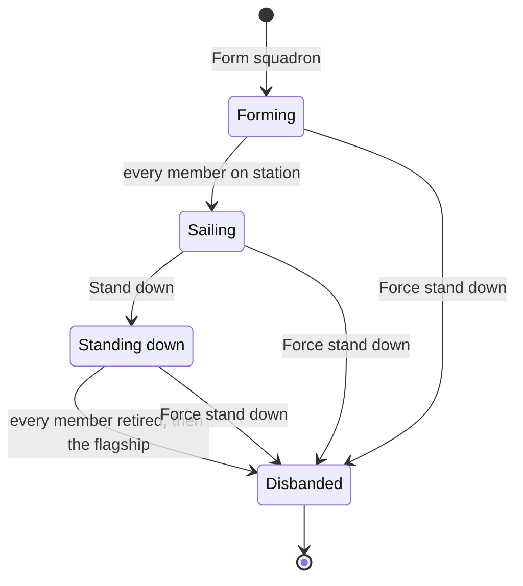
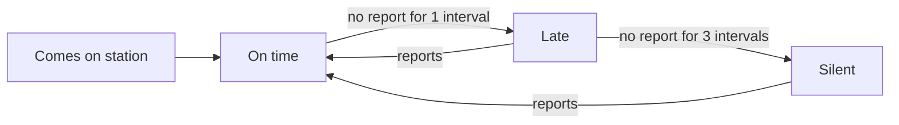
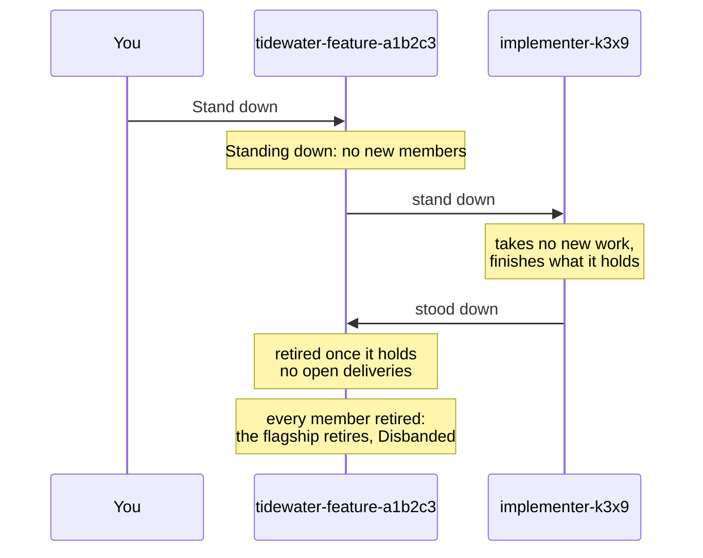

# Run a squadron

Your template and blueprint are in the catalogue, and you are about to form your first [squadron](https://github.com/ThomasHendrickx/aeolus-fleet/blob/main/docs/guide/words.md#squadron), or you just did. This page is the part after the files: forming it, reading how each member is doing, adding and removing members while it works, and standing it down so that no work is lost. Writing the files themselves is [Write a template and blueprint](write-a-template-and-blueprint.md).

Everything here happens on the squadron's page in the [console](https://github.com/ThomasHendrickx/aeolus-fleet/blob/main/docs/guide/words.md#console): Squadrons, then the squadron. A ship that formed a squadron by message can do most of it by message too; see [Run it from a ship](#run-it-from-a-ship).

The examples use the Tidewater set from the sibling page: the squadron `tidewater-feature-a1b2c3`, formed from the blueprint `tidewater-feature` v1, with a planner, two implementers, a reviewer and a tester.

## The life of a squadron

A squadron goes through four states, and only forward:

| State | What it means | What the page offers |
| --- | --- | --- |
| **Forming** | Its [flagship](https://github.com/ThomasHendrickx/aeolus-fleet/blob/main/docs/guide/words.md#flagship) and members are commissioned; not every member has been on station yet | Message, Force stand down |
| **Sailing** | Every member has been on station; the squadron works | Add member, Message, Stand down, Force stand down |
| **Standing down** | Its members finish their open work and are retired one by one | Message, Force stand down |
| **Disbanded** | Every member and the flagship are retired. The squadron, its members and what its flagship kept stay as history | Nothing: it is read-only |

There is no way back. A squadron that has sailed stays Sailing until you stand it down, even when a member drops off: the member's health shows that, not the squadron's state. And there is no disband button: Disbanded is only where standing down ends.

Message sends to the flagship, which is what "message the squadron" means. The flagship keeps any message that is not part of its own work, such as one you send it, and the page shows it under Kept by the flagship.

## Form it

From the blueprint's page, choose Form squadron, or start from Squadrons and pick a blueprint and version. The form shows each member with its crew settings merged from the files, and asks for what the files left open: a parameter no role filled and, when the [trierarch plugin](https://github.com/ThomasHendrickx/aeolus-fleet/blob/main/docs/guide/words.md#trierarch-plugin) crews your ships, a workspace for each member. Form squadron turns on once every member has what it needs. [Write a template and blueprint](write-a-template-and-blueprint.md#what-forming-makes) says what each of these comes from.

Forming commissions the flagship and one ship per member, then each member is crewed:

- **With the trierarch plugin,** each member whose settings name a workspace gets a [crew request](https://github.com/ThomasHendrickx/aeolus-fleet/blob/main/docs/guide/words.md#crew-request), and a computer that fits starts its session. You do nothing more.
- **Without it,** forming shows each member's [crew lines](https://github.com/ThomasHendrickx/aeolus-fleet/blob/main/docs/guide/words.md#crew-line) once: one for Claude Code, one for Codex and one for a chat. Copy each into a new session. They are not stored anywhere, so crew every member before you close the dialog.

Each member's session then checks in at the flagship, gets its role, and confirms it. A member that has confirmed is **on station**. The page shows how many are, and the squadron sails once all of them are.

Forming has no time limit. A member that never checks in keeps the squadron Forming. Give it a new crew line (see [When a member goes quiet](#when-a-member-goes-quiet)), or, if the squadron should not go on, use Force stand down.

## Read each member's health

The squadron page lists the members by role. Each row shows the member's health, the [report](https://github.com/ThomasHendrickx/aeolus-fleet/blob/main/docs/guide/words.md#report) it last made, and its crew as the fleet sees it.

| Health | What it means |
| --- | --- |
| **Not on station** | Its current session has not confirmed its role yet: it was just formed or added, or it has a new session that has not checked in |
| **On time** | On station, and it reported within its check-in interval |
| **Late** | On station, and no report for longer than one check-in interval |
| **Silent** | On station, and no report for longer than three check-in intervals |
| **Standing down** | Its squadron stands down, or you removed it and its session is being let go |

The check-in interval is the template's `checkIn`. With `30m`, a member is late after 30 minutes without a report and silent after 90. The clock runs from its last report, or from when it came on station if it has not reported yet.

Health only observes. A late or silent member is never retired, stopped or replaced for it: what to do is your call.

Two more things show on a member:

- **A model mismatch.** When its template pins a [model](https://github.com/ThomasHendrickx/aeolus-fleet/blob/main/docs/guide/words.md#model) and the member checked in with another, or with none, the member is flagged. It is not stopped.
- **Silent members across the fleet.** Every silent member of a squadron that is not disbanded is also listed on the console's [Health](https://github.com/ThomasHendrickx/aeolus-fleet/blob/main/docs/guide/words.md#health) page, under Silent members, so you see it without opening each squadron.

### When a member goes quiet

A late member may just be busy with a long step: read its last report first. A silent one has usually lost its session: it ended, it was cleared without the plugin, or its computer went away.

Give it a new session with **Get new crew line**: the button on a silent member's row, or in any member's menu. squadrons lets the member's current session go if one holds it, and gives you new crew lines, once. The member keeps its name, its role and its inbox. Its new session checks in like any member, so it shows Not on station until it does.

Do not use the ship page's Recrew or Release on a member. Recrew gives a crew line without the squadron in it, so the new session never checks in and never gets its role. The squadron's page offers no Release for that reason: Get new crew line is how a member gets a new session.

## Add a member

While the squadron is Sailing, choose Add member and pick a role. The dialog shows each role's template version and how many members it has now against how many the blueprint forms. You can add beyond the blueprint's count.

The new member runs the same template version as the rest of its role: squadrons takes it from what it kept when the squadron formed, not from your files now. It is crewed as at forming: a crew request when its settings name a workspace, otherwise its crew lines, shown once. It checks in, is Not on station until it does, and the squadron stays Sailing.

A hand-off to a role goes to the first free member of that role, so a new implementer starts taking work as soon as it is on station.

Your installation may cap how many members a squadron has. Adding beyond it is refused, saying which limit, and no ship is commissioned.

## Remove a member

While the squadron is Sailing or Standing down, open a member's menu and choose **Remove from squadron**. The dialog says what follows:

- **Its ship is [retired](https://github.com/ThomasHendrickx/aeolus-fleet/blob/main/docs/guide/words.md#retire).** A member crewed through a crew request stands down first: squadrons removes the request, its computer lets the session go, and the ship is retired after that. Any other member is retired at once. Its history stays, read-only.
- **Work sent to it by name is abandoned.** If its inbox holds open [deliveries](https://github.com/ThomasHendrickx/aeolus-fleet/blob/main/docs/guide/words.md#delivery), the dialog counts them and asks you to type the member's name. Each is marked Abandoned, and its sender can see that. Work sent to its role, not to its name, goes to another member of the role.
- **The last of a role is allowed.** The dialog warns you. Until you add a member of that role again, a hand-off to it fails when it is sent, as no ship of that type exists.

To replace a member rather than shrink the role, Add member first, then remove the old one once the new one is on station.

## Stand it down

Standing down ends a Sailing squadron without losing work. Choose **Stand down** in the squadron's menu; the dialog counts the open work its members hold.

1. The squadron goes Standing down and takes no new members.
2. A member that never came on station holds no work, so it is retired at once.
3. Every other member is told to stand down. It takes no new work, finishes what it holds, and says it stood down. The Aeolus Fleet plugin for Claude Code and Codex does this part for the member.
4. A member that stood down is retired once it holds no open deliveries. One crewed through a crew request has the request removed first, so no computer starts it again, and is retired once its session is let go.
5. Once every member is retired, the flagship is retired and the squadron is Disbanded.

The progress bar shows how many members are done. A member that checks in while its squadron stands down is told so in its role, finishes its work, and stands down the same way.

A member is never retired before it says it stood down. A member that cannot (its session is gone, or the stand-down never reached it) keeps the squadron Standing down. Then either give it a new crew line, so a new session finishes and stands down, remove it, or force the stand down.

### Force stand down

**Force stand down** ends the squadron now, from Forming, Sailing or Standing down. Every member that is not retired yet, then the flagship, is retired at once, and the squadron is Disbanded. Work they held is abandoned: when there is any, the dialog counts it and asks you to type the squadron's id.

Use it for a squadron that never finished forming, or one stuck standing down. For a squadron that works, Stand down is the clean end.

## Run it from a ship

A ship holding the [scope](https://github.com/ThomasHendrickx/aeolus-fleet/blob/main/docs/guide/words.md#scope) `squadrons:form` can form a squadron by message. It is then that squadron's forming ship, and runs it by messages to the flagship:

| To | It sends the flagship | It needs |
| --- | --- | --- |
| Stand the squadron down | `application/vnd.aeolus.squadron.stand-down+json` | `squadrons:form`, and a Sailing squadron |
| Add a member | `application/vnd.aeolus.squadron.add-member+json`, naming the role | `squadrons:scale`, a Sailing squadron, and a role crewed through a crew request |
| Remove a member | `application/vnd.aeolus.squadron.remove-member+json`, naming the member | `squadrons:scale`, and a Sailing squadron |

The flagship refuses any other ship, except [argo](https://github.com/ThomasHendrickx/aeolus-fleet/blob/main/docs/guide/words.md#argo). What a flagship would tell argo of the squadron goes to the forming ship instead, and once the forming ship is retired its [owner](https://github.com/ThomasHendrickx/aeolus-fleet/blob/main/docs/guide/words.md#owner) takes its place. Force stand down and Get new crew line stay in the console. Every payload and answer is in [Forming by a ship](../squadrons.md#forming-by-a-ship).

## What squadrons does not see

- **A member changed outside its squadron.** Released, recrewed or retired from its ship page, it stays listed as a member; only its health and crew show the change.
- **A flagship released by hand.** It is not crewed again, so check-ins to it go unanswered.
- **squadrons not connected to your fleet.** Flagships already running go on, but no new squadron starts and no stand down moves forward until it is connected again.

## Next

- [Squadrons, the reference](../squadrons.md): crew settings, the check-in and forming by a ship, in full.
- [The squadron lifecycle](../../packages/squadrons/README.md#lifecycle): every state and transition of a squadron and its members.
