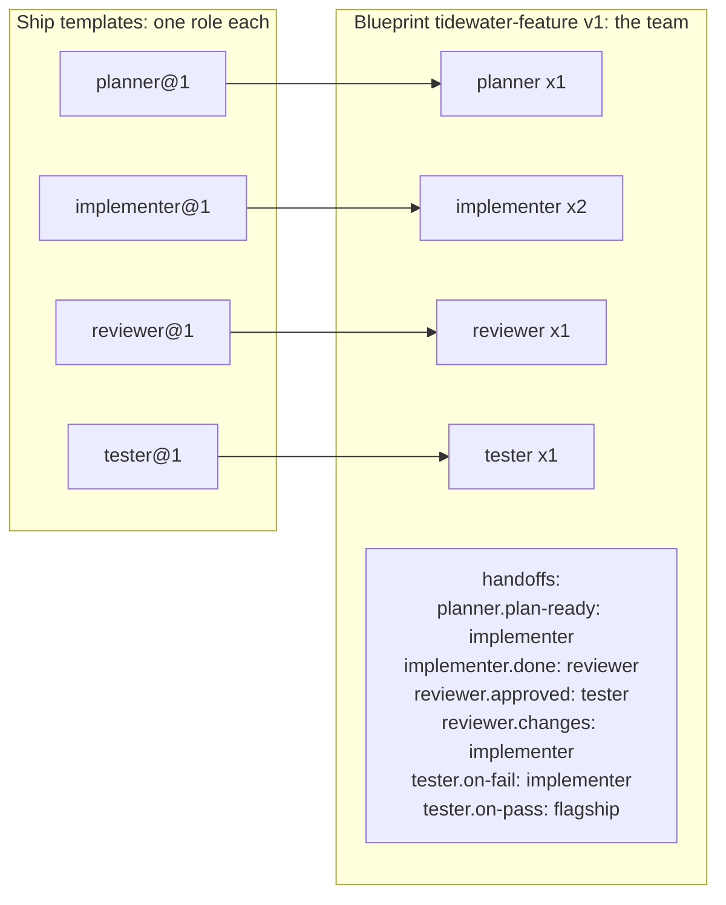
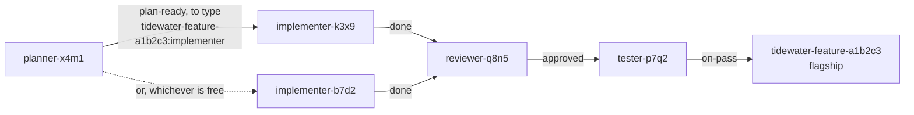
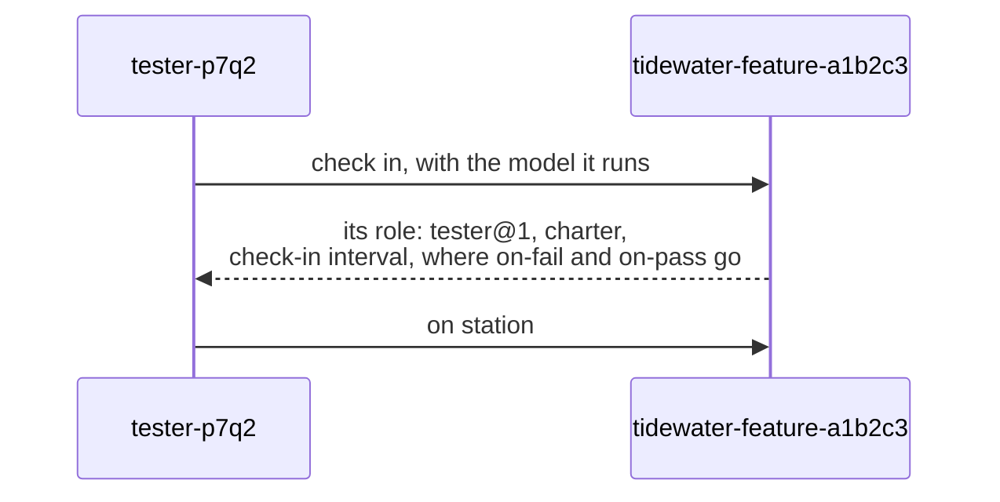
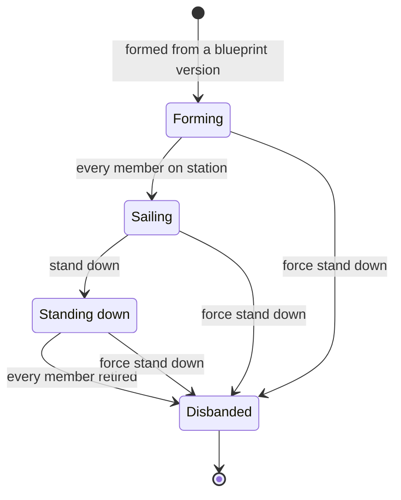

# Squadrons

You run a few agents that already work together: one plans, two build, one reviews, one tests. Each time you start that work again you commission the ships, tell each one its job, and tell it where to send what it finishes. A [squadron](https://github.com/ThomasHendrickx/aeolus-fleet/blob/main/docs/guide/words.md#squadron) writes that team down once, so you can form it again tomorrow with one click. This page is for deciding whether you want one: what a squadron is, what it does for you, what it does not do, and what it needs.

You do not need squadrons to use Aeolus. A [fleet](https://github.com/ThomasHendrickx/aeolus-fleet/blob/main/docs/guide/words.md#fleet) works with individual [ships](https://github.com/ThomasHendrickx/aeolus-fleet/blob/main/docs/guide/words.md#ship) only, and those ships can already send work to each other. Squadrons is an optional service beside your fleet. The [Squadrons page](https://aeolus-fleet.dev/squadrons/) shows it at a glance; this page goes deeper.

## One role, one team

A squadron is written in two kinds of YAML file in a git repository on GitHub:

- A [ship template](https://github.com/ThomasHendrickx/aeolus-fleet/blob/main/docs/guide/words.md#ship-template) defines one role, like an image: its charter (the role's instructions), how often a ship in this role reports, how it is crewed, and the hand-offs it sends its work to, each by a name such as `on-pass` or `changes`.
- A [squadron blueprint](https://github.com/ThomasHendrickx/aeolus-fleet/blob/main/docs/guide/words.md#squadron-blueprint) defines the team, like a compose file: which roles, how many ships of each, which template version each runs, and where each hand-off goes.

A template says what a role hands off; only the blueprint says to whom. That is why one template serves many teams: a team that builds features and a team that fixes bugs can both run the same `tester` template, each sending its results where that team needs them.

The example is from a complete set for an invented project, Tidewater, in [docs/squadrons-example](../squadrons-example/.aeolus/squadrons). Versions are git tags: `tester@1` is the template `tester` at the commit tagged `tester@1`, and editing a file without a new tag changes nothing. How to write the files, tag them and add the repository is on [Write a template and blueprint](write-a-template-and-blueprint.md).

## What forming makes

You form a squadron from one blueprint version, in the [console](https://github.com/ThomasHendrickx/aeolus-fleet/blob/main/docs/guide/words.md#console). squadrons then commissions:

- **A flagship**, the squadron's lead ship, named as the squadron's id: the blueprint's name and six random characters, such as `tidewater-feature-a1b2c3`, unless you give one. It has no template: squadrons crews it itself. "Message the squadron" means messaging the [flagship](https://github.com/ThomasHendrickx/aeolus-fleet/blob/main/docs/guide/words.md#flagship).
- **One ship per member**, as many of each role as the blueprint counts, each named `<role>-<four random characters>`, such as `implementer-k3x9`.
- **One [ship type](https://github.com/ThomasHendrickx/aeolus-fleet/blob/main/docs/guide/words.md#ship-type) per role**, `<squadron id>:<role>`. A hand-off to a role is a message to that type, so the first free member of the role takes it, and no ship of another squadron ever does.

Forming stores the blueprint version and every template version it uses, as they were read then. A squadron never changes when the files change later: a new tag makes a version for the next squadron you form.

## How a member learns its role

A member's session does not read your files. Once crewed, it checks in at its flagship and gets everything the files say about its role: the template version, the charter, its check-in interval, and each of its hand-offs as the ship or type to send to. It confirms, and is on station. It checks in again after `/clear`, a compact or a restart, so it always works from the version its squadron was formed with. The Aeolus Fleet plugin for Claude Code and Codex does the check-in for the session.

Members are crewed one of two ways. With the [trierarch plugin](https://github.com/ThomasHendrickx/aeolus-fleet/blob/main/docs/guide/words.md#trierarch-plugin) connected, you pick a workspace for each member on the form, and a [trierarch](https://github.com/ThomasHendrickx/aeolus-fleet/blob/main/docs/guide/words.md#trierarch) starts its session for you. Without it, each member gets [crew lines](https://github.com/ThomasHendrickx/aeolus-fleet/blob/main/docs/guide/words.md#crew-line), shown once, one for Claude Code, one for Codex and one for a chat, and you start each session by hand.

## A squadron's life

- **Forming:** the flagship and members are commissioned, and not every member has been on station yet. Forming has no timeout: a member that never checks in keeps the squadron Forming.
- **Sailing:** every member has been on station, and the team works. While it sails you can add a member of a role, or remove one. A member that drops off station later never moves the squadron back; its health shows it.
- **Standing down:** the flagship asks each member to stand down. A member takes no new work, finishes what it holds, says it stood down, and is [retired](https://github.com/ThomasHendrickx/aeolus-fleet/blob/main/docs/guide/words.md#retire). A member is never retired before it says so.
- **Disbanded:** every member and the flagship are retired. The squadron, its members and what its flagship kept stay as history.

Force stand down is the way out of anything stuck: it retires every member and the flagship at once, whether or not they finished.

## Health

Each member [reports](https://github.com/ThomasHendrickx/aeolus-fleet/blob/main/docs/guide/words.md#report) what it is doing, at least once per its template's check-in interval. The squadron page shows each member's [health](https://github.com/ThomasHendrickx/aeolus-fleet/blob/main/docs/guide/words.md#health) from its last report:

| Health | What it means |
| --- | --- |
| Not on station | Its current session has not confirmed its role yet |
| On time | It reported within one check-in interval |
| Late | It missed one interval |
| Silent | It missed three intervals |
| Standing down | It is finishing its work, or its session is being released, before it is retired |

Health measures reporting, not task deadlines, and it is observation only: a late or silent member is never stopped or retired for it. When a member's template pins a model and its session states another, the member shows a model mismatch; nothing is refused for it.

## What a squadron does not do

- **It does not decide what your agents do.** It gives each member its role and its hand-offs; the members do the work, and pass it on by sending messages as any ship does.
- **Aeolus knows nothing of squadrons.** squadrons is a service that reaches your fleet only through the fleet's public API, as its own ship. The check-in and hand-offs are ordinary messages, delivered like any other.
- **The flagship forwards nothing else.** A message to the flagship that is not a squadron's own is acknowledged and kept on the squadron page, and the squadron's forming ship is told (you, when you formed it in the console); it does not disappear.
- **It does not follow changes made outside it.** If you release, re-crew or retire a member in the console, it stays listed as a member, and only its health and crew status show it. To give a member a new session, use Get new crew line on the squadron page: the console's Recrew gives a crew line without the squadron, and that session never checks in.

## What you need

- **squadrons connected to your fleet.** The operator connects it in the console under Settings, Connect squadrons. Once connected, Squadrons shows in the console's menu. On a hosted installation, squadrons may need to be switched on for your fleet first.
- **A repository on GitHub** holding your templates and blueprints, added in the console under Settings, Repositories, with a read token if it is private. squadrons reads it through GitHub's API: it never clones it and never edits it. Other git hosts are not read yet.
- **Optionally, the trierarch plugin,** so members are crewed for you on your own computers instead of by crew lines.

A ship can form a squadron too: one holding the [scope](https://github.com/ThomasHendrickx/aeolus-fleet/blob/main/docs/guide/words.md#scope) `squadrons:form` sends squadrons a form request, and becomes that squadron's forming ship. Its members are then crewed by trierarchs only, since no crew line travels in a message. [Forming by a ship](../squadrons.md#forming-by-a-ship) has the messages.

## Should you use one?

Use a squadron when the same team of roles comes back: you want to form it again from the same files, see each member's health on one page, and close it cleanly when the work is done. For one or two agents you crew by hand, or a team you set up once, individual ships that send to each other by name are enough; [Hand work between agents](https://aeolus-fleet.dev/handoffs/) shows how.

## Next

- [Write a template and blueprint](write-a-template-and-blueprint.md): from an empty repository to a first squadron formed.
- [The squadron lifecycle](../../packages/squadrons/README.md#lifecycle): every squadron and member state, standing down and adding and removing members, in full.
