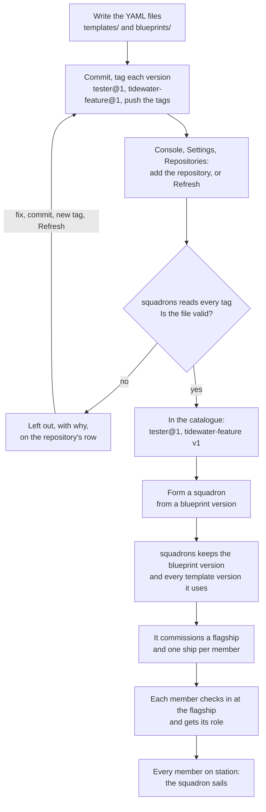
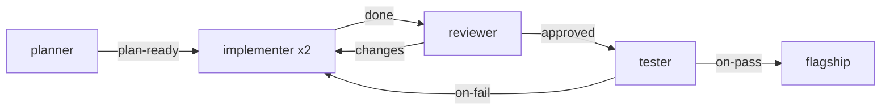
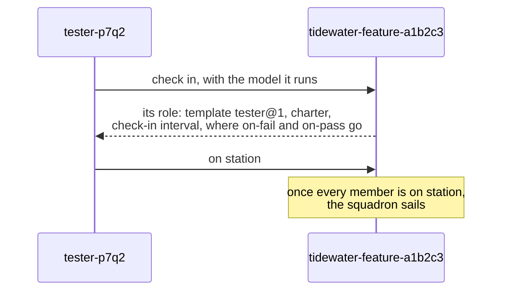

# Write a template and blueprint

You want a team of agents: one plans, two build, one reviews, one tests, and each knows where to send its work next. In Aeolus that team is a [squadron](https://github.com/ThomasHendrickx/aeolus-fleet/blob/main/docs/guide/words.md#squadron), and before you can form one you write it down in two kinds of file. This page takes you from an empty repository to a first template and blueprint that form a squadron.

## Two files, like a Dockerfile and a compose file

A squadron is written in YAML files in a git repository on GitHub.

- A [ship template](https://github.com/ThomasHendrickx/aeolus-fleet/blob/main/docs/guide/words.md#ship-template) is one role, like an image: what a ship in this role does, how often it reports, how it is crewed, and the hand-offs it sends its work to.
- A [squadron blueprint](https://github.com/ThomasHendrickx/aeolus-fleet/blob/main/docs/guide/words.md#squadron-blueprint) is the team, like a compose file: which roles, how many ships of each, which template version each runs, and where each hand-off goes.

One template serves many blueprints. A team that builds features and a team that fixes bugs can both use the same `tester` template.

squadrons, the service beside your fleet that forms and leads squadrons, reads these files from GitHub. It never clones your repository and never edits it: you write the files, commit them and tag them, and squadrons reads what the tags point at.

## Where the files go

In the repository, under `.aeolus/squadrons/`:

```text
.aeolus/squadrons/
  templates/
    planner.yaml
    implementer.yaml
    reviewer.yaml
    tester.yaml
  blueprints/
    tidewater-feature.yaml
    tidewater-fix.yaml
```

- One file is one template or one blueprint, and its file name without `.yaml` is its name: `templates/tester.yaml` is the template `tester`.
- A name is lowercase letters, digits, hyphens or colons. A file named `Tester.yaml` or `tester.yml` is not read.
- A repository can keep these folders somewhere else. You then give that folder as its path when you add the repository in the console.

The examples on this page come from a complete set for an invented project, Tidewater, an app with tide tables for small harbours. The whole set is in [docs/squadrons-example](../squadrons-example/.aeolus/squadrons), in a repository named `github.com/tidewater-labs/squadron-templates`. Put your own repository's name wherever this page writes that one.

## Versions are tags

A file on `main` is not a version yet. A version is a git tag on the commit that holds the file:

- Version `n` of the template `tester` is the tag `tester@n`, a whole number from 1: `tester@1`, then `tester@2`.
- A blueprint's versions are tagged the same way, by its file name: `tidewater-feature@1`.
- A new version is a new commit with a new tag. Editing a file without a new tag changes nothing.
- Never move a tag. squadrons would read the moved tag as that version without a warning, and squadrons formed before would keep the old one.

`Tester@1`, `tester-1`, `tester@v1` and `tester@1.0` are no versions. A tag such as `v1.0.0` is no version tag at all and is ignored, so your release tags can live in the same repository.

## From files to a formed squadron



Two moments read your files:

- **Adding or refreshing the repository** reads every version tag and checks each file. What passes is in the catalogue; what fails is left out with the reason. squadrons never fetches on a timer, so after pushing a new tag, choose Refresh.
- **Forming a squadron** keeps the blueprint version and every template version it uses, as they were read then. The squadron never changes when your files change later. A new tag reaches only the squadrons you form after it.

## Write a template

A template is one role. This is the Tidewater tester:

```yaml
# templates/tester.yaml, version 1 once tagged tester@1
description: Runs the end-to-end suite on a branch and reports the result.
checkIn: 30m
charter: |
  You test the branch you are given with the whole end-to-end suite.
  When tests fail, send the failing tests and their output to on-fail.
  When they pass, send the branch and the run to on-pass.
handoffs:
  on-fail: The failing tests and their output
  on-pass: The branch and the run that passed
crew:
  machineLabels:
    - os=linux
    - arch=amd64
```

Three fields are required:

| Field | What it says |
| --- | --- |
| `description` | One line, shown in the template lists |
| `checkIn` | How often a member reports what it does: `30m` or `2h`, from 1 minute to 24 hours. A member that misses one interval shows as late, three as silent |
| `charter` | The role's instructions, as you would brief the agent. Each member gets it, as written, when it checks in. At most 48 KB |

The rest is optional:

| Field | What it says |
| --- | --- |
| `handoffs` | The names the charter sends work to, each with what it carries. The template only names them; a blueprint decides where each one goes |
| `parameters` | Values the template leaves to the squadron, used as `{{name}}` in the charter, such as the part of the code a planner works in |
| `launchNote` | Shown to a person above the role's crew lines: where to start the session |
| `crew` | How members are crewed: the [harness](https://github.com/ThomasHendrickx/aeolus-fleet/blob/main/docs/guide/words.md#harness), the exact [model](https://github.com/ThomasHendrickx/aeolus-fleet/blob/main/docs/guide/words.md#model), the [workspace](https://github.com/ThomasHendrickx/aeolus-fleet/blob/main/docs/guide/words.md#workspace), options such as `effort`, the machine labels a computer must carry, a first prompt and MCP servers |
| `scopes` | The [scopes](https://github.com/ThomasHendrickx/aeolus-fleet/blob/main/docs/guide/words.md#scope) each member gets when it is commissioned. Most roles need none |
| `labels` | [Labels](https://github.com/ThomasHendrickx/aeolus-fleet/blob/main/docs/guide/words.md#label) every member carries, such as `company=aeolus` |
| `base` | Another template version this one builds on; see [Build on another template](#build-on-another-template) |

A few rules save a failed read:

- **The model goes in `crew.model`**, as an exact id such as `claude-opus-5-5`, never `opus` or a name ending in `-latest`. A member that checks in with another model is flagged, not stopped. Leave the model out and a member may run any.
- **Machine labels are `key=value`**, such as `os=linux`: never a key alone.
- **A workspace names repositories and folders**, never a path. Each computer knows where its copies live.

### A parameter, filled later

The Tidewater planner leaves its area open:

```yaml
# templates/planner.yaml
description: Turns a feature request into a plan the implementers can follow.
checkIn: 1h
parameters:
  area: The part of Tidewater the features touch, such as the tide tables
charter: |
  You plan one feature of Tidewater at a time, in {{area}}.
  Read the request from the flagship, study the code it touches, and write a
  plan of small steps, each with the files it changes and how to test it.
  Send the plan to your plan-ready hand-off.
handoffs:
  plan-ready: The plan, one step per line, with the branch to build it on
crew:
  model: claude-opus-5-5
  firstPrompt: Wait for the flagship's feature request, then plan it.
```

A blueprint role can fill `area`. One no role fills is asked for when the squadron is formed. A `{{name}}` the template does not declare under `parameters` is refused.

### Build on another template

A template can build on one other template version, as a Dockerfile builds `FROM` one image, and say only what differs:

```yaml
# templates/typescript-implementer.yaml
base:
  template: github.com/tidewater-labs/squadron-templates#implementer@1
description: Implements a step in a TypeScript repository
charter: |
  Run npm run typecheck before every commit.
```

Its charter is added after its base's; `base.replaceCharter: true` replaces it instead. `base.parameters` fills parameters the base leaves open. The base names a version that is tagged, never "latest", and a new base version reaches this template only through a new version of it. A chain holds at most 10 templates.

## Write a blueprint

A blueprint is the team. This is Tidewater's feature squadron:

```yaml
# blueprints/tidewater-feature.yaml, version 1 once tagged tidewater-feature@1
description: Plans, builds, reviews and tests one feature of Tidewater.
roles:
  planner:
    template: github.com/tidewater-labs/squadron-templates#planner@1
  implementer:
    template: github.com/tidewater-labs/squadron-templates#implementer@1
    count: 2
  reviewer:
    template: github.com/tidewater-labs/squadron-templates#reviewer@1
  tester:
    template: github.com/tidewater-labs/squadron-templates#tester@1
handoffs:
  planner.plan-ready: implementer
  implementer.done: reviewer
  reviewer.approved: tester
  reviewer.changes: implementer
  tester.on-fail: implementer
  tester.on-pass: flagship
```

| Field | What it says |
| --- | --- |
| `description` | Required. One line |
| `roles` | Required. Each role's name, the template version it runs, and `count`, how many ships (1 when left out, at most 20) |
| `handoffs` | Where each hand-off goes: `<role>.<hand-off>: <role or flagship>` |
| `name` | Another name than the file's. Its tags still use the file name |
| `memberNames` | `plain`, the default, or `prefixed`; see [What forming makes](#what-forming-makes) |

A role names its template as `<repository>#<name>@<n>`: the repository's name as you added it, the template's name, and a version tagged there. Never a branch or a commit. The repository's name is its URL without `https://` and `.git`, letter case exact: added as `https://github.com/Tidewater-Labs/squadron-templates`, it is `github.com/Tidewater-Labs/squadron-templates`, and a lowercase reference does not find it.

A role can also set `crew` over its template's and fill `parameters`. Each crew field the role sets replaces the template's, except `options`, which merge per key. `tidewater-fix` runs its implementer on another harness and model this way:

```yaml
roles:
  implementer:
    template: github.com/tidewater-labs/squadron-templates#implementer@1
    crew:
      harness: codex
      model: gpt-6-sol
      options:
        effort: low
```

### Where each hand-off goes

Every hand-off a template declares must be bound, to one of the blueprint's roles or to `flagship`, and nothing else may be bound. A hand-off to a role goes to the first free ship of that role, so with two implementers the plan reaches whichever is free. A hand-off to `flagship` comes back to the squadron's lead ship.

The feature squadron's hand-offs:



## What forming makes

When you form a squadron from a blueprint version:

- **The squadron** gets an id: the blueprint's name and six random characters, such as `tidewater-feature-a1b2c3`, unless you give one.
- **The [flagship](https://github.com/ThomasHendrickx/aeolus-fleet/blob/main/docs/guide/words.md#flagship)** is a ship named as the squadron id. It has no template: squadrons crews it itself. "Message the squadron" means messaging it.
- **Each member** is a ship named `<role>-<four random characters>`, such as `implementer-k3x9`. With `memberNames: prefixed` it is `<squadron id>:<role>-<n>`, such as `tidewater-fix-a1b2c3:implementer-1`.
- **Each role** is a [ship type](https://github.com/ThomasHendrickx/aeolus-fleet/blob/main/docs/guide/words.md#ship-type) of its own, `<squadron id>:<role>`. That is how a hand-off reaches one free member of the role, and never a ship of another squadron.

The values your files leave open are asked for on the form: a parameter no role filled, and, when the [trierarch plugin](https://github.com/ThomasHendrickx/aeolus-fleet/blob/main/docs/guide/words.md#trierarch-plugin) crews your ships, a workspace for each member. The form shows each member's crew settings merged from its files, and you can change any of them for that member. Form squadron turns on once every member has what it needs. Without the trierarch plugin, each member gets [crew lines](https://github.com/ThomasHendrickx/aeolus-fleet/blob/main/docs/guide/words.md#crew-line), shown once, and you crew it by hand.

### The check-in

A member's session does not read your files. It checks in at its flagship, and the flagship answers with everything the files say about its role:



The member checks in again after `/clear`, a compact or a restart, so it always works from the template version its squadron was formed with. The Aeolus Fleet plugin for Claude Code and Codex does the check-in for you.

## Your first template and blueprint

Start small: one role, its results coming back to the flagship. In your repository:

**1. Write the template**, `.aeolus/squadrons/templates/tester.yaml`, as in [Write a template](#write-a-template).

**2. Tag it and push the tag.**

```sh
git add .aeolus/squadrons/templates/tester.yaml
git commit -m "Template tester, version 1"
git tag tester@1
git push origin main tester@1
```

**3. Write the blueprint**, `.aeolus/squadrons/blueprints/tidewater-check.yaml`. Its name must differ from every template's name in the repository: one tag reads both folders.

```yaml
description: Tests one branch of Tidewater and reports the result.
roles:
  tester:
    template: github.com/tidewater-labs/squadron-templates#tester@1
handoffs:
  tester.on-fail: flagship
  tester.on-pass: flagship
```

**4. Tag it and push the tag.**

```sh
git add .aeolus/squadrons/blueprints/tidewater-check.yaml
git commit -m "Blueprint tidewater-check, version 1"
git tag tidewater-check@1
git push origin main tidewater-check@1
```

The blueprint's tag and the template's tag may point at different commits: each file is read at its own tag.

**5. Add the repository.** In the [console](https://github.com/ThomasHendrickx/aeolus-fleet/blob/main/docs/guide/words.md#console), Settings, Repositories: add it by its https URL on github.com, with a read token if it is private. Already added? Choose Refresh. The repository's row shows `tester@1` and `tidewater-check` v1. If either is left out, the row says why; fix the file, commit, tag the next version and Refresh.

**6. Form the squadron** from `tidewater-check` v1. You get a flagship, `tidewater-check-<six characters>`, and one member, `tester-<four characters>`. Crew it, by its crew line or through the trierarch plugin. It checks in, takes up its charter, and the squadron sails.

From here, grow it the same way: a second template, a new role in the blueprint, a hand-off bound to it, and a new tag, `tidewater-check@2`. Squadrons formed from v1 keep v1.

## If something is left out

The repository's row in Settings, Repositories names every version left out and why. The usual causes:

| The row says | What to do |
| --- | --- |
| A tag with no file of its name | `tester@1` reads only `templates/tester.yaml` and `blueprints/tester.yaml` at its commit. Check the file name and the commit the tag points at |
| A reference to a repository squadrons does not know | Write the repository's name exactly as added, letter case too, or add the repository |
| A template at no tag, or a version not tagged | Tag the template version first, push the tag, then Refresh |
| An unbound or unknown hand-off | Bind every hand-off the templates declare, each to a role of the blueprint or `flagship`, and nothing else |
| A model outside `crew.model` | Move it to `crew.model` of the template or the role |
| A wrong field | Which field, and what it expects: `checkIn` as `30m` or `2h`, a machine label as `os=linux`, an exact model id |
| Two blueprints of one name, or a blueprint with a template's name | Give the blueprint its own name, by its file name or `name` |

A changed file with no new tag is not an error, so the row says nothing: tag it.

## More

Every field, every limit and every rule of reading and building is in the reference, [Squadrons: templates, blueprints and the check-in](../squadrons.md).

## Next

- [Squadrons, the reference](../squadrons.md): crew settings, template bases and forming by a ship, in full.
- [The squadron lifecycle](../../packages/squadrons/README.md#lifecycle): forming, sailing, each member's health, and standing a squadron down.
